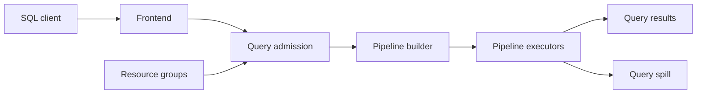

# StarRocks/starrocks

> Moteur SQL analytique distribué pour requêtes ad hoc sub-seconde, sur entrepôt ou lakehouse.

## Le problème
Les requêtes analytiques multi-dimensionnelles lentes obligent à dénormaliser ou à déplacer les données vers un autre système.

## Ce que ça fait vraiment
Serveur SQL compatible protocole MySQL : un frontend Java (parsing, optimiseur CBO, admission) et des backends C++ vectorisés qui exécutent en pipelines parallèles. Lit directement Hive, Iceberg, Delta Lake, Hudi. Upsert/delete sur clé primaire, vues matérialisées, groupes de ressources par locataire. Mode shared-data depuis la 3.0.

## Comment c'est branché

## Essayer
Aucune commande dans le README ; renvoi aux Quick Starts du site de documentation.

## Coût et pièges
Gratuit, mais cluster FE + BE à opérer ; 1 557 issues ouvertes. Les chiffres de vitesse (3x, 5 à 10x) sont ceux du README, non vérifiés ici.

## Ce que ce n'est pas
Pas une base OLTP ni un outil de BI. Le README ne détaille pas le chemin d'implémentation des vues matérialisées ni du lac.

## Alternatives
Aucune alternative nommée dans le README.

## Pour toi
À surveiller si tu sers des tableaux de bord sur un lac de données : projet Linux Foundation, actif (push le 2026-10-23), mais lourd à opérer pour un usage solo.

