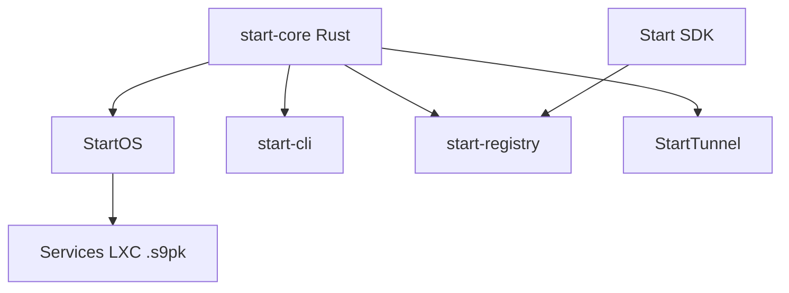

# Start9Labs/start-os

> Open source Linux distribution for self-hosting a personal server of services.

## The problem
Self-hosting Bitcoin, Nextcloud, Vaultwarden or Matrix means assembling networking, backups, dependencies and monitoring by hand.

## What it actually does
Start9 monorepo: StartOS (server system), start-cli, package registry, StartTunnel (VPN and forwarding), StartWRT (OpenWrt router) and an SDK to package services as .s9pk. Rust backend, Angular interface, services in LXC containers, reactive state through Patch-DB.

## How it is wired
Simplified diagram based on the sheet, no diagram provided.


## Trying it
```bash
git clone https://github.com/Start9Labs/start-technologies.git
cd start-technologies
```

## Cost and gotchas
The simplest way is to buy a Start9 server or install on your own hardware. Building an image follows AGENTS.md.

## What it is not
Not a cluster orchestrator nor an MLOps platform. The catalog is mostly Bitcoin and privacy.

## Alternatives
No alternative named in the README.

## For you
Watch: interesting for a sovereign homelab, but not designed for AI workloads.
