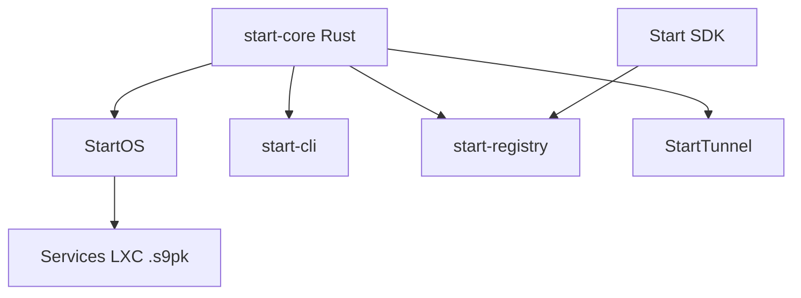

# Start9Labs/start-os

> Distribution Linux open source pour héberger soi-même un serveur personnel de services.

## Le problème
Auto-héberger Bitcoin, Nextcloud, Vaultwarden ou Matrix suppose d'assembler réseau, sauvegardes, dépendances et supervision à la main.

## Ce que ça fait vraiment
Monorepo Start9 : StartOS (système serveur), start-cli, registre de paquets, StartTunnel (VPN et redirection), StartWRT (routeur OpenWrt) et SDK pour empaqueter des services en .s9pk. Backend Rust, interface Angular, services dans des conteneurs LXC, état réactif par Patch-DB.

## Comment c'est branché
Schéma simplifié d'après la fiche, sans diagramme fourni.


## Essayer
```bash
git clone https://github.com/Start9Labs/start-technologies.git
cd start-technologies
```

## Coût et pièges
Le plus simple est d'acheter un serveur Start9 ou d'installer sur son matériel. Compiler une image suit AGENTS.md.

## Ce que ce n'est pas
Pas un orchestrateur de cluster ni une plateforme MLOps. Le catalogue est surtout Bitcoin et vie privée.

## Alternatives
Aucune alternative nommée dans le README.

## Pour toi
Surveiller : intéressant pour un homelab souverain, mais pas conçu pour des charges d'IA.

