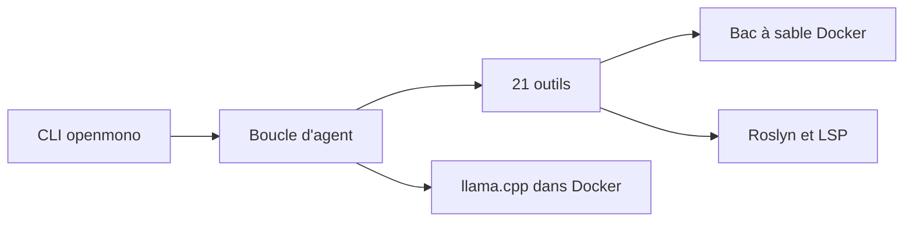

# StartupHakk/OpenMonoAgent.ai

> A local coding agent in .NET, with an embedded llama.cpp server, to code with no cloud and no subscription.

## The problem
Coding agents send your code and prompts to a third party and bill per token. Here the goal is to keep everything on your machine.

## What it actually does
A .NET 10 CLI drives an agent loop with 21 tools, 5 sub-agents and a Docker sandbox (the project mounted at `/workspace`). An embedded llama.cpp serves a model chosen according to the hardware (Qwen, Bonsai). Roslyn and LSP provide code analysis. An optional "Agent Host" mode runs commands on the machine.

## How it is wired
Simplified diagram based on the card, no diagram provided.



## Trying it
```bash
bash <(curl -fsSL https://raw.githubusercontent.com/StartupHakk/OpenMonoAgent.ai/refs/heads/main/get-openmono.sh)
openmono agent
openmono agent --classic
```

## Cost and gotchas
Free after installation, but you need hardware: CPU mode requires about 20 GB of RAM, GPU models need 12 to 24 GB cards. Agent Host mode breaks the sandbox isolation, by design.

## What it is not
Not a stable product: the README speaks of a public beta. The OpenAI, Anthropic and Ollama providers are marked "WIP". The license is present but not identified by GitHub.

## Alternatives
No alternative named in the README.

## For you
Worth watching: a 100% local coding agent is attractive for sensitive code, but the license to clarify and the beta status call for waiting.
