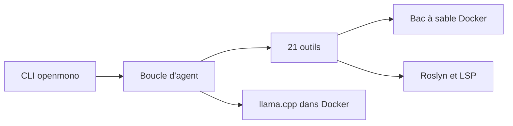

# StartupHakk/OpenMonoAgent.ai

> Un agent de code local en .NET, avec serveur llama.cpp embarqué, pour coder sans cloud ni abonnement.

## Le problème
Les agents de code envoient ton code et tes prompts chez un tiers et facturent au jeton. Ici le but est de tout garder sur ta machine.

## Ce que ça fait vraiment
Une CLI .NET 10 pilote une boucle d'agent avec 21 outils, 5 sous-agents et un bac à sable Docker (le projet monté en `/workspace`). Un llama.cpp embarqué sert un modèle choisi selon le matériel (Qwen, Bonsai). Roslyn et LSP fournissent l'analyse de code. Un mode « Agent Host » optionnel exécute des commandes sur la machine.

## Comment c'est branché
Schéma simplifié d'après la fiche, sans diagramme fourni.



## Essayer
```bash
bash <(curl -fsSL https://raw.githubusercontent.com/StartupHakk/OpenMonoAgent.ai/refs/heads/main/get-openmono.sh)
openmono agent
openmono agent --classic
```

## Coût et pièges
Gratuit après l'installation, mais il faut du matériel : le mode CPU demande environ 20 Go de RAM, les modèles GPU des cartes de 12 à 24 Go. Le mode Agent Host brise l'isolation du bac à sable, par conception.

## Ce que ce n'est pas
Pas un produit stable : le README parle de bêta publique. Les fournisseurs OpenAI, Anthropic et Ollama sont marqués « WIP ». La licence est présente mais non identifiée par GitHub.

## Alternatives
Aucune alternative nommée dans le README.

## Pour toi
À surveiller : un agent de code 100 % local intéresse pour du code sensible, mais la licence à clarifier et le statut bêta demandent d'attendre.

