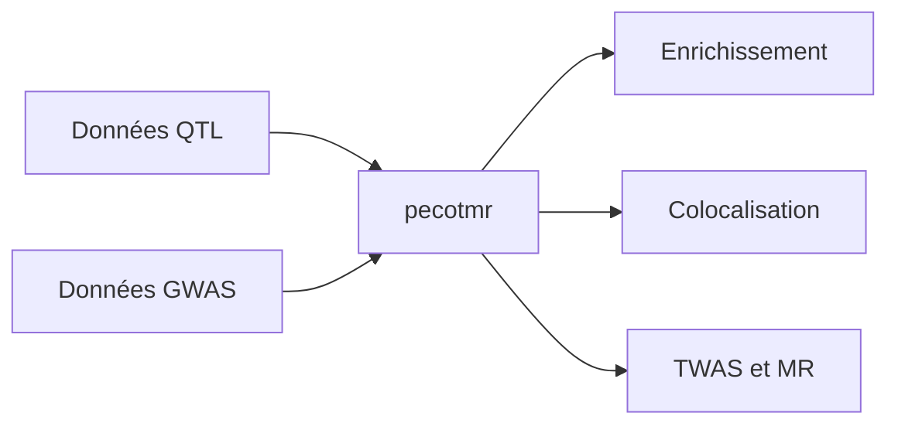

# StatFunGen/pecotmr

> R package for post-GWAS analysis (enrichment, colocalization, TWAS, Mendelian randomization) for geneticists.

## The problem
Linking QTLs to GWAS signals requires chaining scattered, poorly integrated models.

## What it actually does
Brings together enrichment, colocalization, TWAS and Mendelian randomization, mostly from fine-mapped single-effect models. Developed by the FunGen-xQTL group (NIH/NIA). Part of the code is in C++ (cpp11).

## How it is wired
Simplified diagram based on the fiche, no diagram provided.



## Trying it
```bash
micromamba install -c dnachun -c conda-forge -c bioconda r-pecotmr
```
```r
BiocManager::install("StatFunGen/pecotmr")
```

## Cost and gotchas
Free. Needs R, a C++ compiler to build, or conda/micromamba. GPL-3.0 license (copyleft).

## What it is not
Not a general-purpose ML tool: it targets statistical genetics.

## Alternatives
No alternative named in the README.

## For you
Ignore: specialized statistical genetics, only useful in bioinformatics.
