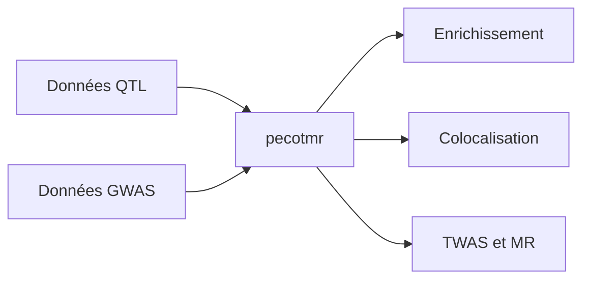

# StatFunGen/pecotmr

> Paquet R d'analyse post-GWAS (enrichissement, colocalisation, TWAS, randomisation mendélienne) pour généticiens.

## Le problème
Relier les QTL aux signaux GWAS demande d'enchaîner des modèles épars et mal intégrés.

## Ce que ça fait vraiment
Regroupe enrichissement, colocalisation, TWAS et randomisation mendélienne, surtout à partir de modèles à effets uniques fine-mappés. Développé par le groupe FunGen-xQTL (NIH/NIA). Une partie du code est en C++ (cpp11).

## Comment c'est branché
Schéma simplifié d'après la fiche, sans diagramme fourni.



## Essayer
```bash
micromamba install -c dnachun -c conda-forge -c bioconda r-pecotmr
```
```r
BiocManager::install("StatFunGen/pecotmr")
```

## Coût et pièges
Gratuit. Besoin de R, d'un compilateur C++ pour compiler, ou de conda/micromamba. Licence GPL-3.0 (copyleft).

## Ce que ce n'est pas
Pas un outil généraliste de ML : il vise la génétique statistique.

## Alternatives
Aucune alternative nommée dans le README.

## Pour toi
À ignorer : génétique statistique spécialisée, utile seulement en bio-informatique.

