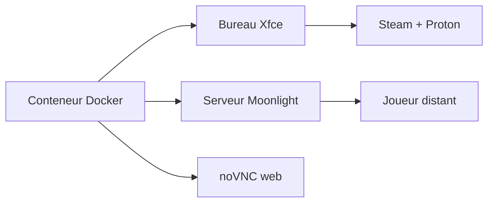

# Steam-Headless/docker-steam-headless

> Docker container hosting Steam and an Xfce desktop to stream games remotely.

## The problem
Playing on a server without a screen requires installing Steam, Proton, a streaming server and a remotely accessible desktop.

## What it actually does
Provides an Xfce desktop reachable through noVNC with audio, a Moonlight-compatible server, Steam with Proton, and Flatpak for Lutris, Heroic or EmuDeck. Handles NVIDIA, AMD and Intel GPUs and game controllers. Based on Debian Trixie. The `~/init.d/*.sh` scripts run at startup.

## How it is wired

## Trying it
No documented command (the Docker Compose, Unraid and Ubuntu Server installation links have no content in the text read).

## Cost and gotchas
A GPU is needed for decent gaming. Only the home directory and mounts persist. For Remote Play, a dedicated network with its own IP is required. The container has root access and SSH, listed as to be removed in the TODO.

## What it is not
Not a hosted cloud gaming service. No documented procedure for TrueNAS Scale or other server OSes.

## Alternatives
No alternative named in the README.

## For you
Ignore: a game server is outside the data/AI scope, unless you reuse your server's GPU.
