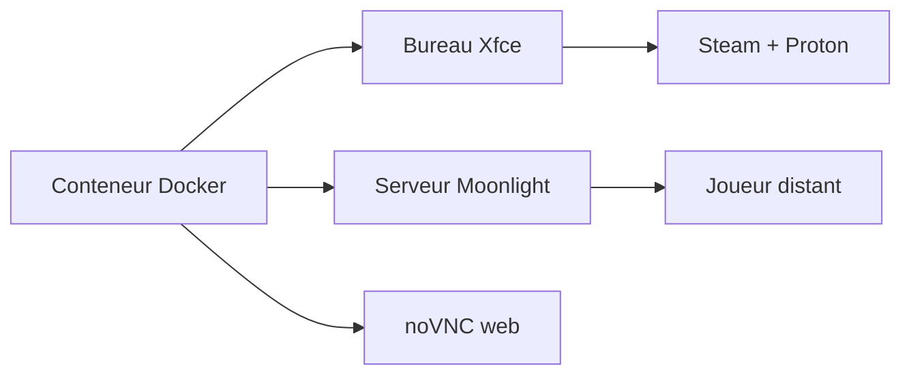

# Steam-Headless/docker-steam-headless

> Conteneur Docker qui héberge Steam et un bureau Xfce pour streamer des jeux à distance.

## Le problème
Jouer sur un serveur sans écran exige d'installer Steam, Proton, un serveur de streaming et un bureau accessible à distance.

## Ce que ça fait vraiment
Fournit un bureau Xfce accessible par noVNC avec audio, un serveur compatible Moonlight, Steam avec Proton, et Flatpak pour Lutris, Heroic ou EmuDeck. Gère GPU NVIDIA, AMD, Intel et les manettes. Basé sur Debian Trixie. Les scripts `~/init.d/*.sh` s'exécutent au démarrage.

## Comment c'est branché

## Essayer
Aucune commande documentée (les liens d'installation Docker Compose, Unraid et Ubuntu Server n'ont pas de contenu dans le texte lu).

## Coût et pièges
Un GPU est nécessaire pour un jeu correct. Seul le répertoire personnel et les montages persistent. Pour Remote Play, il faut un réseau dédié avec IP propre. Le conteneur a un accès root et SSH, listés comme à retirer dans la TODO.

## Ce que ce n'est pas
Pas un service de cloud gaming hébergé. Pas de procédure documentée pour TrueNAS Scale ni d'autres OS serveur.

## Alternatives
Aucune alternative nommée dans le README.

## Pour toi
À ignorer : serveur de jeu hors du périmètre data/IA, sauf si tu réutilises ton GPU de serveur.

