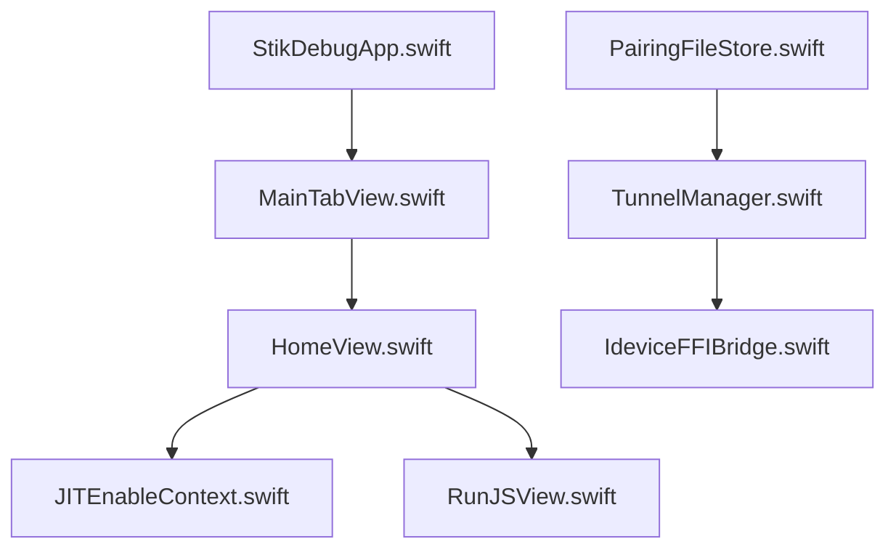

# StephenDev0/StikDebug

> iOS app that enables JIT for apps installed outside the App Store, on iOS 17.4 and later.

## The problem
Sideloaded iOS applications cannot use JIT compilation without going through a computer.

## What it actually does
Enables JIT for apps that have the `get-task-allow` entitlement, launches apps, shows logs, device information and processes, simulates GPS location and runs JavaScript scripts. Goes through a tunnel and a pairing file, with a loopback VPN.

## How it is wired


## Trying it
```bash
git clone https://github.com/StikDebug/StikDebug.git
cd StikDebug
```
Then open `StikDebug.xcodeproj` in Xcode, configure signing and run.

## Cost and gotchas
Free. Requires a pairing file, a loopback VPN and a sideload tool; no longer available on the App Store. Build on macOS with Xcode 16 or later.

## What it is not
Not a general-purpose debugging tool nor a jailbreak. Does not work before iOS 17.4.

## Alternatives
SideStore and AltStore, cited as refresh tools.

## For you
Ignore: used for iOS sideloading, unrelated to data / AI / MLOps work.
