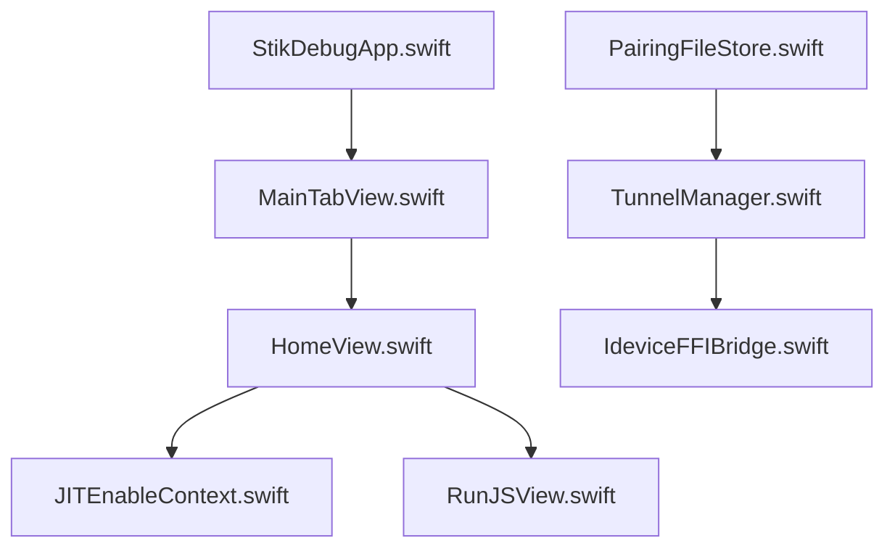

# StephenDev0/StikDebug

> Application iOS qui active le JIT pour des apps installées hors App Store, sur iOS 17.4 et plus.

## Le problème
Les applications sideloadées sur iOS ne peuvent pas utiliser la compilation JIT sans passer par un ordinateur.

## Ce que ça fait vraiment
Active le JIT pour les apps ayant l'entitlement `get-task-allow`, lance des apps, affiche journaux, informations d'appareil et processus, simule la position GPS et exécute des scripts JavaScript. Passe par un tunnel et un fichier d'appairage, avec un VPN en boucle locale.

## Comment c'est branché


## Essayer
```bash
git clone https://github.com/StikDebug/StikDebug.git
cd StikDebug
```
Puis ouvrir `StikDebug.xcodeproj` dans Xcode, configurer la signature et lancer.

## Coût et pièges
Gratuit. Exige un fichier d'appairage, un VPN en boucle locale et un outil de sideload ; plus disponible sur l'App Store. Compilation sous macOS avec Xcode 16 ou plus.

## Ce que ce n'est pas
Pas un outil de débogage généraliste ni de jailbreak. Ne fonctionne pas avant iOS 17.4.

## Alternatives
SideStore et AltStore, cités comme outils de rafraîchissement.

## Pour toi
Ignorer : sert au sideload iOS, sans lien avec un travail data / IA / MLOps.

