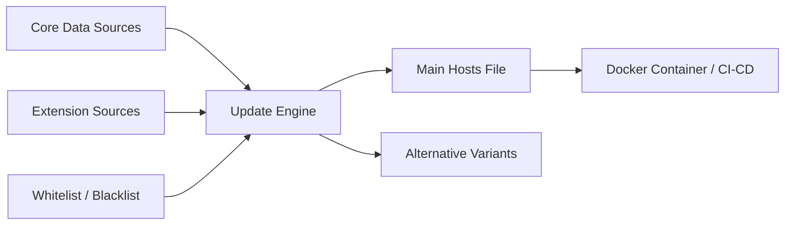

# StevenBlack/hosts

> Unified, deduplicated hosts file, aggregated from third-party lists, to block ads and malicious sites.

## The problem
Blocking ad networks, trackers and dubious domains on all devices, without maintaining dozens of lists yourself.

## What it actually does
Aggregates hosts files from third-party sources (AdAway, MVPS, URLHaus, yoyo.org...), merges them, removes duplicates and publishes the base (76,229 entries) plus 31 variants with optional extensions: fakenews, gambling, pornography, social networks. A Python script (`updateHostsFile.py`) regenerates the file, with whitelist, blacklist and custom entries. Domains are redirected to `0.0.0.0`.

## How it is wired


## Trying it
```bash
git clone --depth 1 https://github.com/StevenBlack/hosts.git
pip3 install --user -r requirements.txt
python3 updateHostsFile.py [--auto] [--replace] [--ip nnn.nnn.nnn.nnn] [--extensions ext1 ext2 ext3]
docker run --pull always --rm -it -v /etc/hosts:/etc/hosts \
ghcr.io/stevenblack/hosts:latest updateHostsFile.py --auto \
--replace --extensions gambling porn
```

## Cost and gotchas
Free. The Docker option replaces `/etc/hosts`. On Windows, a large file may require disabling the DNS Cache service or compressing the list. Cloning the full history is slow: use `--depth 1`.

## What it is not
Not a firewall nor an antivirus: it only blocks by domain name. The repository is MIT, but some aggregated sources have their own licenses (CC BY-NC-SA 4.0 for MVPS, "non-commercial" for someonewhocares): check before any commercial use. Content reports go to the original source.

## Alternatives
- Pi-hole: network-wide blocking, which uses this repository as a source.
- dnscrypt-proxy: builds blocklists from common formats.
- Unbound: DNS resolver that can load these lists.

## For you
Adopt: a simple, proven way to filter ad domains on workstations and servers, but check the sources' licenses if you redistribute.
