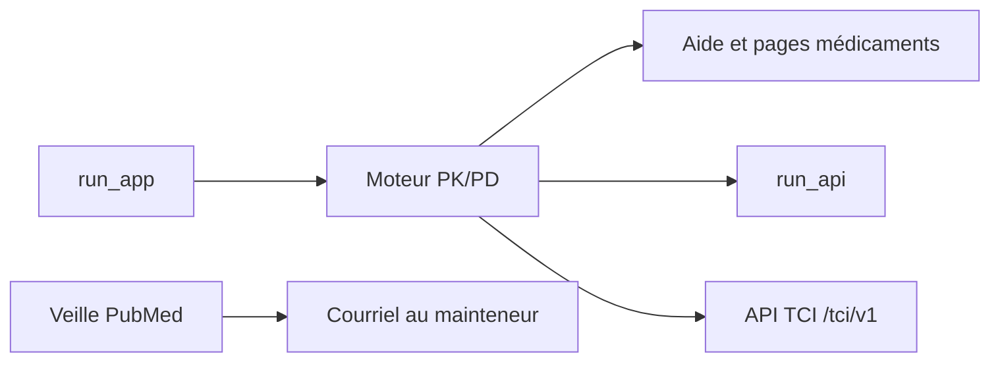

# StevenLShafer/stanpumpR

> Web-based pharmacokinetic and pharmacodynamic simulator in R Shiny, for teaching, research and clinical use.

## The problem
Predicting a drug's concentration for a given dosing schedule requires PK/PD models that are scattered and hard to access.

## What it actually does
A Shiny application that simulates a drug's concentration for any dosing regimen (intravenous, oral, subcutaneous, regional, inhaled routes). It exposes a simulation API (`run_api()`, `apiSimulate()`) and a stateless TCI API. Since October 2026, a scheduled Claude Code routine queries PubMed every week and emails promising studies; it does not modify the code.

## How it is wired
Simplified diagram based on the sheet, no diagram provided.


## Trying it
```bash
# Dans la console R, après renv::restore() et copie de config.yml.sample en config.yml :
devtools::load_all(".")
run_app()
devtools::test()
```

## Cost and gotchas
R version pinned by `renv.lock`, `config.yml` to create. On Windows, install the precompiled zip (installing from source may fail).

## What it is not
Not an infusion-control tool: an educational and advisory tool, not validated by any health authority. MIT license claimed in the README but not recognized by GitHub.

## Alternatives
None named in the README.

## For you
Worth watching: a polished example of Shiny with an API and agent-driven literature monitoring, but the medical domain is outside your core work.
