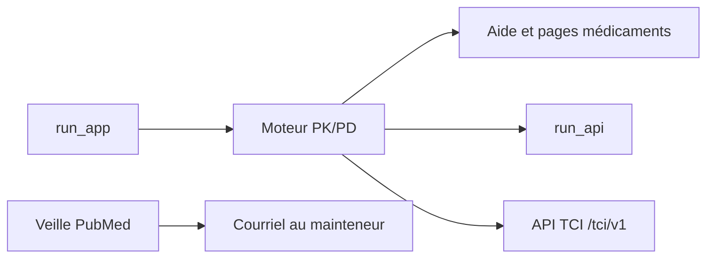

# StevenLShafer/stanpumpR

> Simulateur web pharmacocinétique et pharmacodynamique en R Shiny, pour l'enseignement, la recherche et la clinique.

## Le problème
Prévoir la concentration d'un médicament selon un schéma de dose demande des modèles PK/PD dispersés et peu accessibles.

## Ce que ça fait vraiment
Application Shiny qui simule la concentration d'un médicament pour toute posologie (voies intraveineuse, orale, sous-cutanée, régionale, inhalée). Elle expose une API de simulation (`run_api()`, `apiSimulate()`) et une API TCI sans état. Depuis octobre 2026, une routine Claude Code planifiée interroge PubMed chaque semaine et envoie par courriel les études prometteuses ; elle ne modifie pas le code.

## Comment c'est branché
Schéma simplifié d'après la fiche, sans diagramme fourni.


## Essayer
```bash
# Dans la console R, après renv::restore() et copie de config.yml.sample en config.yml :
devtools::load_all(".")
run_app()
devtools::test()
```

## Coût et pièges
Version de R fixée par `renv.lock`, `config.yml` à créer. Sur Windows, installer le zip précompilé (l'installation depuis les sources peut échouer).

## Ce que ce n'est pas
Pas un outil de pilotage de perfusion : outil pédagogique et consultatif, non validé par une autorité de santé. Licence MIT annoncée dans le README mais non reconnue par GitHub.

## Alternatives
Aucune nommée dans le README.

## Pour toi
À surveiller : exemple soigné de Shiny avec API et veille bibliographique pilotée par un agent, mais domaine médical hors cœur de métier.

