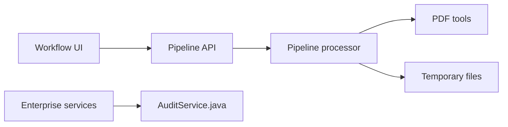

# Stirling-Tools/Stirling-PDF

> Open-source PDF platform, for use on desktop, in a web browser, or as a private server with an API.

## The problem
Online PDF tools require sensitive documents to be sent to a third party.

## What it actually does
Over 50 tools: merging, cutting, signing, stamping, conversion, OCR, compression. Code-free workflows within the interface and a REST API process files in batches, with a single output file or ZIP archive. A business offering includes SSO, auditing, accounts and teams, encrypted storage, and usage-based billing. The interface is available in over 40 languages.

## How it is wired


## Trying it
```bash
docker run -p 8080:8080 docker.stirlingpdf.com/stirlingtools/stirling-pdf
```
Then, access it at http://localhost:8080.

## Cost and gotchas
Free for self-hosting; a paid server and enterprise plan are available. Docker is required. The license is not recognized by GitHub.

## What it is not
Not a document structure extractor for LLMs: it's an editing tool. The enterprise features require a paid subscription.

## Alternatives
No alternative is specified in the README.

## For you
Designed for OCR and PDF preprocessing locally, without exposing documents, via a REST API within a pipeline.
