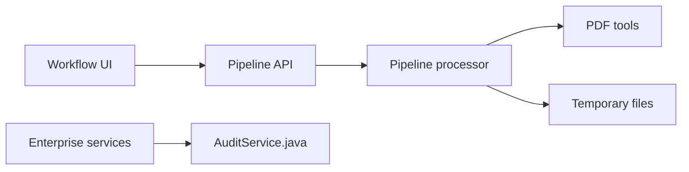

# Stirling-Tools/Stirling-PDF

> Plateforme PDF open source, en application de bureau, navigateur ou serveur privé avec API.

## Le problème
Les outils PDF en ligne obligent à envoyer des documents sensibles à un tiers.

## Ce que ça fait vraiment
Plus de 50 outils : fusion, découpe, signature, caviardage, conversion, OCR, compression. Des pipelines sans code dans l'interface et une API REST traitent les fichiers en lot, avec réponse en fichier unique ou ZIP. Une offre entreprise ajoute SSO, audit, comptes et équipes, stockage chiffré et facturation d'usage. L'interface existe en plus de 40 langues.

## Comment c'est branché


## Essayer
```bash
docker run -p 8080:8080 docker.stirlingpdf.com/stirlingtools/stirling-pdf
```
Puis http://localhost:8080.

## Coût et pièges
Gratuit en auto-hébergement ; un plan serveur et entreprise payant existe. Docker requis. La licence n'est pas identifiée par GitHub.

## Ce que ce n'est pas
Pas un extracteur de structure de documents pour LLM : c'est un atelier d'édition. Les fonctions entreprise sont payantes.

## Alternatives
Aucune alternative nommée dans le README.

## Pour toi
À adopter pour OCR et prétraitement de PDF en local sans exposer de documents, via l'API REST dans un pipeline.

