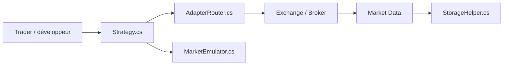

# StockSharp/StockSharp

> C# algorithmic trading platform: broker and exchange connectors, strategies, market data, backtesting.

## The problem
Every broker and every exchange has its own API; writing a trading bot that speaks to all of them takes a long time.

## What it actually does
A C# API (`Connector`, `Subscription`, `Order`) that abstracts hundreds of connectors (crypto, stocks, forex, DEX). Around it: Designer (visual strategies), Hydra (data storage), Terminal (charts), Shell (graphical framework). The code also exposes an emulation engine to replay history.

## How it is wired


## Trying it
```bash
# Aucune commande shell dans le README ; extrait C# fourni :
# var connector = new Connector();
# connector.Subscribe(subscription);
# connector.Connect();
```

## Cost and gotchas
The software is free, but each broker or data provider requires its own account, sometimes even a paid subscription. Real orders put your money at stake.

## What it is not
Not a turnkey profitable strategy: it is the tooling. The exact licenses of the products (Designer, Hydra...) are not detailed in the README. No native Python.

## Alternatives
No alternative named in the README.

## For you
Keep an eye on it: useful if you do quant in C#/.NET, but the unidentified license and the .NET ecosystem make it poorly suited to a Python/MLOps profile.
