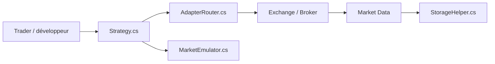

# StockSharp/StockSharp

> Plateforme C# de trading algorithmique : connecteurs courtiers et bourses, stratégies, données de marché, backtest.

## Le problème
Chaque courtier et chaque bourse a son API ; écrire un robot de trading qui les parle toutes est long.

## Ce que ça fait vraiment
Une API C# (`Connector`, `Subscription`, `Order`) qui abstrait des centaines de connecteurs (crypto, actions, forex, DEX). Autour : Designer (stratégies visuelles), Hydra (stockage de données), Terminal (graphiques), Shell (cadre graphique). Le code expose aussi un moteur d'émulation pour rejouer l'historique.

## Comment c'est branché


## Essayer
```bash
# Aucune commande shell dans le README ; extrait C# fourni :
# var connector = new Connector();
# connector.Subscribe(subscription);
# connector.Connect();
```

## Coût et pièges
Le logiciel est gratuit, mais chaque courtier ou fournisseur de données exige son propre compte, voire un abonnement payant. Les ordres réels engagent ton argent.

## Ce que ce n'est pas
Pas une stratégie rentable clé en main : c'est l'outillage. Les licences exactes des produits (Designer, Hydra…) ne sont pas détaillées dans le README. Pas de Python natif.

## Alternatives
Aucune alternative nommée dans le README.

## Pour toi
À surveiller : utile si tu fais du quant en C#/.NET, mais la licence non identifiée et l'écosystème .NET le rendent peu adapté à un profil Python/MLOps.

