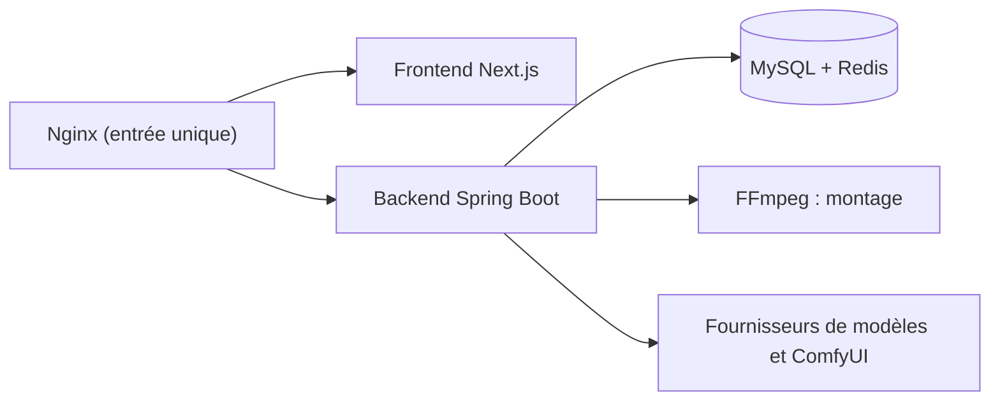

# Stonewuu/ai-fusion-video

> A web agent platform for video creators: script, storyboard, image and video generation.

## The problem
Producing a video with generative models scatters the script, shots, assets and model calls across several tools.

## What it actually does
A single workspace: projects organized by episodes and scenes, storyboard, an infinite canvas linking generation, editing and export, an agent assistant with tools, MCP, skills and sub-agents, and ComfyUI workflows tied to models. Text, image and video models are configured in the interface (compatible with OpenAI, Anthropic, Gemini, DashScope, Ollama). Media goes to disk or S3 storage.

## How it is wired
Simplified diagram based on the fiche, no diagram provided.



## Trying it
```bash
git clone https://github.com/Stonewuu/ai-fusion-video.git
cd ai-fusion-video
cp .env.example .env
docker compose up -d
```

## Cost and gotchas
Text, image and video models are billed by the chosen provider. The MySQL and Redis passwords default to 123456: change them before any public exposure. Cloud models require a resource address reachable from the Internet.

## What it is not
Not a generation model: it orchestrates those of other providers. The README is in Chinese, mixes sponsors and advertising, and gives no license for third-party components.

## Alternatives
No alternative cited in the README.

## For you
Ignore: a video creation platform aimed at Chinese creators, offering you little on the data / AI / MLOps side, with weak default credentials.
