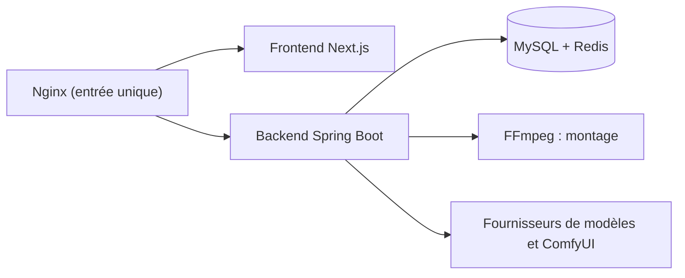

# Stonewuu/ai-fusion-video

> Plateforme web d'agents pour créateurs de vidéo : scénario, storyboard, génération d'images et de vidéos.

## Le problème
Produire une vidéo avec des modèles génératifs oblige à disperser scénario, plans, assets et appels de modèles entre plusieurs outils.

## Ce que ça fait vraiment
Un espace de travail unique : projets par épisodes et scènes, storyboard, canevas infini reliant génération, montage et export, assistant agent avec outils, MCP, compétences et sous-agents, workflows ComfyUI associés à des modèles. Les modèles texte, image et vidéo se configurent dans l'interface (compatibles OpenAI, Anthropic, Gemini, DashScope, Ollama). Les médias vont sur disque ou stockage S3.

## Comment c'est branché
Schéma simplifié d'après la fiche, sans diagramme fourni.



## Essayer
```bash
git clone https://github.com/Stonewuu/ai-fusion-video.git
cd ai-fusion-video
cp .env.example .env
docker compose up -d
```

## Coût et pièges
Les modèles de texte, d'image et de vidéo sont facturés chez le fournisseur choisi. Les mots de passe MySQL et Redis valent 123456 par défaut : à changer avant toute exposition publique. Les modèles cloud exigent une adresse de ressources accessible depuis Internet.

## Ce que ce n'est pas
Pas un modèle de génération : il orchestre ceux d'autres fournisseurs. Le README est en chinois, mêle sponsors et publicité, et ne donne pas de licence des composants tiers.

## Alternatives
Aucune alternative citée dans le README.

## Pour toi
À ignorer : plateforme de création vidéo orientée créateurs chinois, qui t'apporte peu côté data / IA / MLOps, avec des identifiants par défaut faibles.

