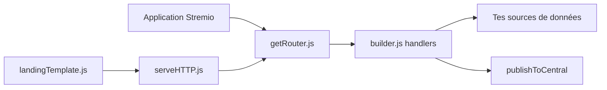

# Stremio/stremio-addon-sdk

> Official Node.js SDK for writing Stremio addons (catalogs, metadata, streams, subtitles).

## The problem
A Stremio addon must answer a precise HTTP/JSON protocol, with CORS and a manifest, which is repetitive to write.

## What it actually does
An `addonBuilder` declares the manifest and the handlers (catalog, meta, stream, subtitles, addon_catalog); `serveHTTP` starts a server, `getRouter` mounts the addon as an Express router. It provides CORS, an installation page, TypeScript types and `publishToCentral` to list the addon. Stremio never runs your code: it calls your endpoints.

## How it is wired


## Trying it
```bash
npm install -g stremio-addon-sdk
addon-bootstrap hello-world
cd hello-world
npm install
npm start -- --launch
```

## Cost and gotchas
Free. The addon must be reachable over HTTPS with CORS (except on 127.0.0.1); hosting is on you (BeamUp suggested). 78 open issues.

## What it is not
Not a content provider: the SDK supplies no video sources.

## Alternatives
stremio-addon-sdk-rs (Rust, third-party) and go-stremio (Go, third-party), cited in the README, for other languages.

## For you
Ignore: a good SDK but for the Stremio media ecosystem, unrelated to data, AI or MLOps.
