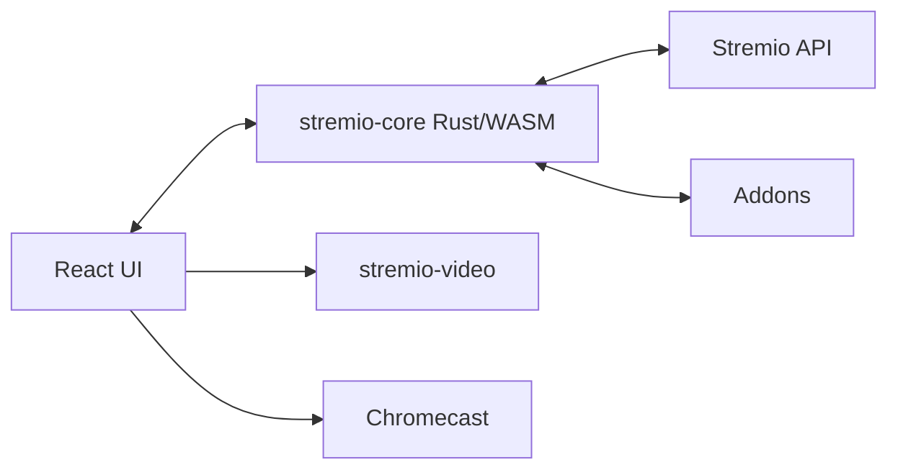

# Stremio/stremio-web

> Official web interface of Stremio, an addon-powered media center, for viewers.

## The problem
Bring movies, series and channels from multiple sources into a single interface synchronized across devices.

## What it actually does
React application; the logic (state, addon protocol, library, sync) lives in stremio-core, a Rust engine compiled to WebAssembly in a Web Worker. Playback via stremio-video. Supports Chromecast, subtitles, 50+ languages, installable PWA.

## How it is wired


## Trying it
```bash
pnpm install
pnpm start
docker build -t stremio-web .
docker run -p 8080:8080 stremio-web
```

## Cost and gotchas
Free; Node.js 22+ and pnpm 11+. Content depends on third-party addons and the Stremio account.

## What it is not
Not the engine: the "brain" is in stremio-core, another repository. Does not provide content.

## Alternatives
No alternative cited in the README.

## For you
To ignore: entertainment application unrelated to data/AI; only the React + Rust/WASM example may be of interest.
