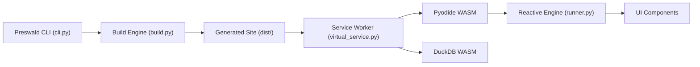

# StructuredLabs/preswald

> Static site generator for interactive Python data apps that run offline in the browser.

## The problem
Delivering an interactive dashboard or report often means hosting a server, or asking the recipient to install Python. Here, everything must fit in a folder that opens in a browser.

## What it actually does
You write the app in Python (`text`, `table`, `get_df` components…). `preswald export` produces a static site in `dist/` that bundles the code, the data, Pyodide (Python in WebAssembly) and DuckDB WASM for SQL queries. A reactive engine with a dependency graph reruns only what changes. A service worker acts as a virtual file system. The architecture description points to a `telemetry.py` module that optionally sends anonymous usage metrics.

## How it is wired


## Trying it
```bash
pip install preswald
preswald init my_app
cd my_app
preswald run
preswald export
```

## Cost and gotchas
Free. `preswald run` starts a development server on `localhost:8501`. Secrets go in `secrets.toml`: do not export them into `dist/`. The exact behavior of the telemetry is not described in the README: check the code before using it on sensitive data.

## What it is not
It is not an application server: there is no backend at runtime. The data is embedded in the bundle, which sets a size and confidentiality limit as soon as the file is shared. The README speaks of "large data" without giving a figure.

## Alternatives
No alternative named in the README (it only mentions "heavier web application platforms").

## For you
Worth watching: the idea of delivering a data report as a single offline folder is useful, but 330 open issues and telemetry to audit justify a trial on a non-sensitive dataset before adopting it.
