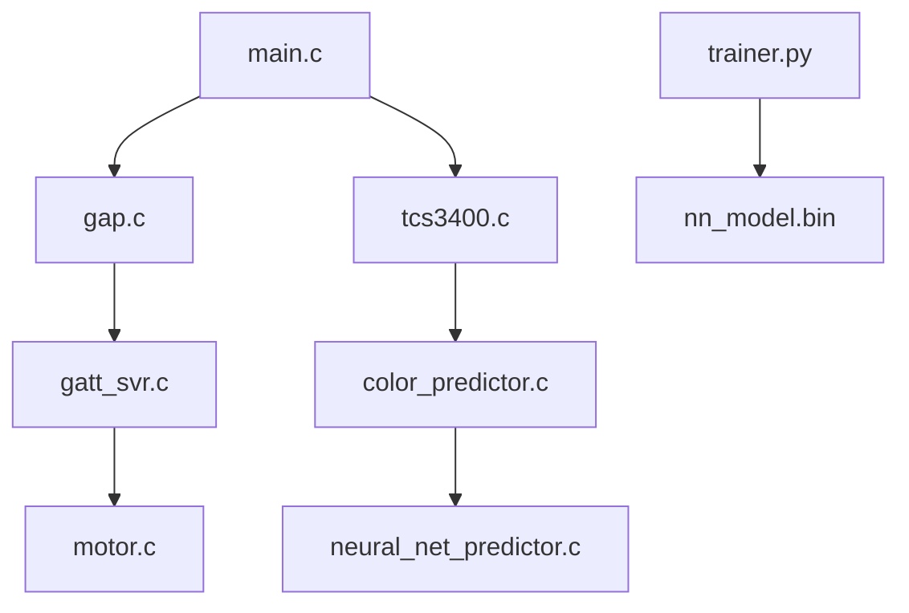

# StuckAtPrototype/Racer

> Mini ESP32-H2 remote-controlled car with a color sensor and a small neural network, for hobbyists.

## The problem
A small Bluetooth-controllable robot that reacts to colors requires firmware, boards, parts and training.

## What it actually does
The repository brings together four parts: firmware, hardware (schematics, gerbers, KiCad), mechanics (STEP files, wheels to print in SLA) and Python scripts. The firmware advertises a Bluetooth service that drives the motors and reads the tcs3400 color sensor for a neural network prediction. `trainer.py` trains the model from `color_data.txt`; `controller.py` drives it from the keyboard.

## How it is wired


## Trying it
```bash
python trainer.py
python controller.py
```

## Cost and gotchas
Free, Apache-2.0. Requires ESP-IDF 5.3.1, a USB-serial adapter, an SLA printer for the wheels and boards to have manufactured. Python 3 and several pip modules for the scripts. The author also sells a kit.

## What it is not
Not a ready-to-run robot: you have to build and solder it. Line following and LLM integration are listed as "to do".

## Alternatives
- Thumbtroller: the same author's hardware remote control for this car.

## For you
Worth watching out of curiosity: a concrete example of a small neural network embedded on an ESP32, but a hobby project with no MLOps relevance.
