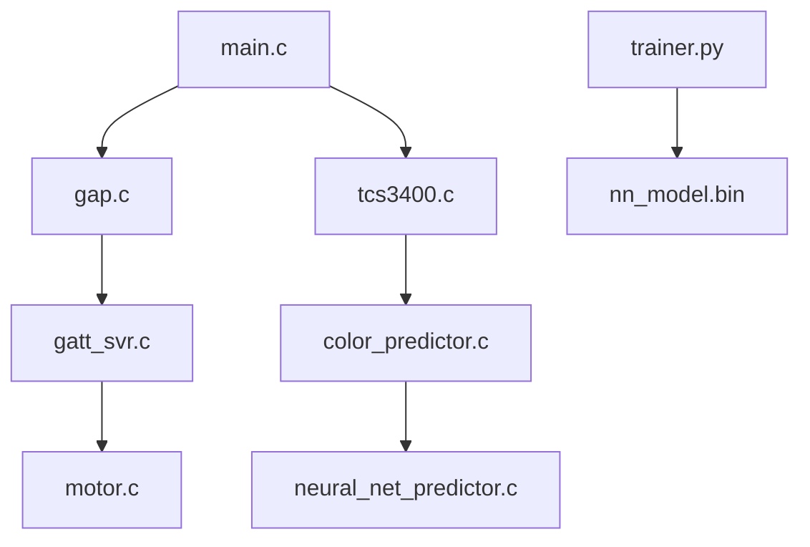

# StuckAtPrototype/Racer

> Mini voiture télécommandée ESP32-H2 avec capteur de couleur et petit réseau de neurones, pour bricoleurs.

## Le problème
Un petit robot pilotable en Bluetooth qui réagit aux couleurs demande firmware, cartes, pièces et entraînement.

## Ce que ça fait vraiment
Le dépôt réunit quatre parties : firmware, matériel (schémas, gerbers, KiCad), mécanique (fichiers STEP, roues à imprimer en SLA) et scripts Python. Le firmware annonce un service Bluetooth qui commande les moteurs et lit le capteur de couleur tcs3400 pour une prédiction par réseau de neurones. `trainer.py` entraîne le modèle depuis `color_data.txt` ; `controller.py` pilote au clavier.

## Comment c'est branché


## Essayer
```bash
python trainer.py
python controller.py
```

## Coût et pièges
Gratuit, Apache-2.0. Il faut ESP-IDF 5.3.1, un adaptateur USB-série, une imprimante SLA pour les roues et les cartes à faire fabriquer. Python 3 et plusieurs modules pip pour les scripts. L'auteur vend aussi un kit.

## Ce que ce n'est pas
Pas un robot prêt à rouler : il faut fabriquer et souder. Le suivi de ligne et l'intégration de LLM sont listés comme « à faire ».

## Alternatives
- Thumbtroller : la télécommande matérielle du même auteur pour cette voiture.

## Pour toi
À surveiller par curiosité : exemple concret d'un petit réseau de neurones embarqué sur ESP32, mais projet de bricolage sans portée MLOps.

