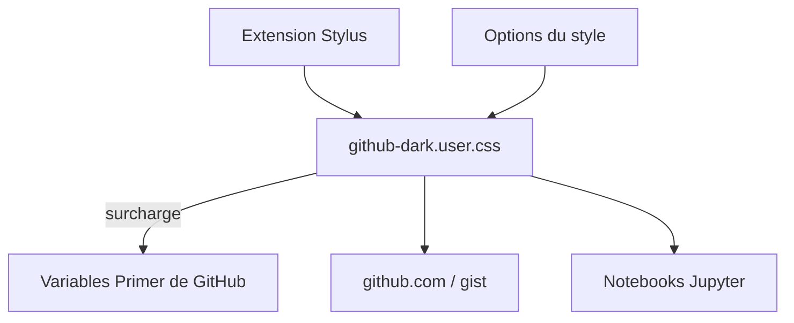

# StylishThemes/GitHub-Dark

> Dark theme for github.com, installed as a user style in Stylus.

## The problem
GitHub's dark theme can't be tuned: background, base color and syntax highlighting are imposed.

## What it actually does
A `github-dark.user.css` file overrides GitHub's Primer CSS variables and a few stable rules. It offers a base color, backgrounds (patterns or a custom image), syntax themes for code, CodeMirror and Jupyter, and tab size. It covers github.com, gist and other GitHub domains.

## How it is wired


## Trying it
```bash
make install
make lint
```
User-side installation: Stylus then `github-dark.user.css`, with GitHub in dark mode.

## Cost and gotchas
Free. Requires Stylus (or Cascadea on Safari) and GitHub's dark mode enabled. Background images are limited by GitHub's CSP.

## What it is not
Not a theme for an application outside GitHub. It relies on GitHub's variables, which may change.

## Alternatives
- Refined GitHub (cited): follows the theme automatically via CSS variables.

## For you
Ignore for data/AI work: it is visual comfort, with no effect on your tooling.
