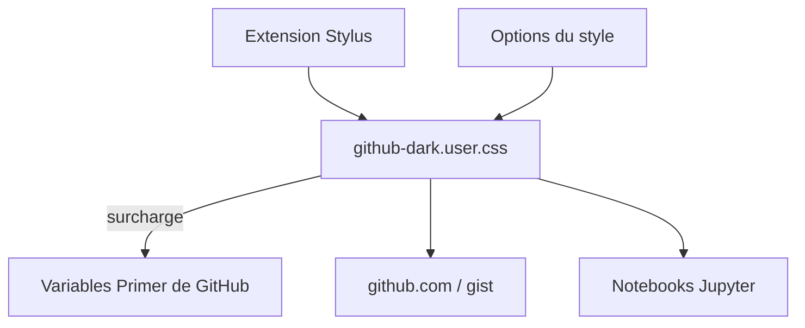

# StylishThemes/GitHub-Dark

> Thème sombre pour github.com, installé comme style utilisateur dans Stylus.

## Le problème
Le thème sombre de GitHub ne se règle pas : fond, couleur de base et coloration syntaxique sont imposés.

## Ce que ça fait vraiment
Un fichier `github-dark.user.css` surcharge les variables CSS Primer de GitHub et quelques règles stables. Il propose couleur de base, fonds (motifs ou image perso), thèmes syntaxiques pour code, CodeMirror et Jupyter, taille de tabulation. Il couvre github.com, gist et d'autres domaines GitHub.

## Comment c'est branché


## Essayer
```bash
make install
make lint
```
Installation côté utilisateur : Stylus puis `github-dark.user.css`, avec GitHub en mode sombre.

## Coût et pièges
Gratuit. Il faut Stylus (ou Cascadea sur Safari) et activer le mode sombre de GitHub. Les images de fond sont limitées par la CSP de GitHub.

## Ce que ce n'est pas
Pas un thème pour une application hors GitHub. Il s'appuie sur les variables de GitHub, qui peuvent évoluer.

## Alternatives
- Refined GitHub (cité) : suit le thème automatiquement via les variables CSS.

## Pour toi
À ignorer pour le travail data/IA : c'est du confort visuel, sans effet sur ton outillage.

