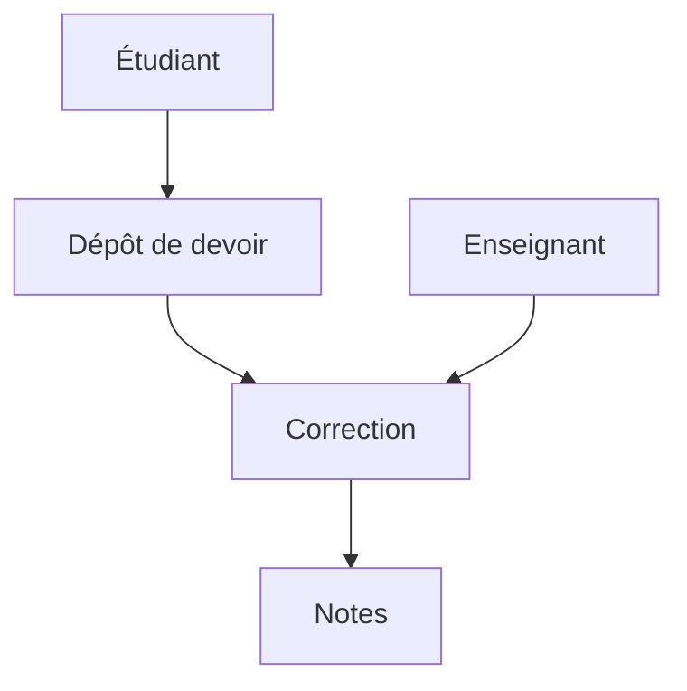

# Submitty/Submitty

> Open-source system for course management, assignment submission and grading, from RPI university.

## The problem
Computer science teachers need to automatically grade code assignments and manage exams and grades.

## What it actually does
The README does not detail it: it points to submitty.org for features and instructions. Based on the description, it is a system for course management, submission, exams and grading.

## How it is wired
Simplified diagram based on the sheet, no diagram provided.

## Trying it
No documented command: instructions are on submitty.org.

## Cost and gotchas
Not documented in the README. A full course system is deployed on a server: read the installation on the site.

## What it is not
Not an MLOps tool: it is an educational platform. Insufficient material to judge the architecture.

## Alternatives
No alternative cited in the README.

## For you
Ignore: a course platform outside your scope, unless you teach or grade code in bulk.
