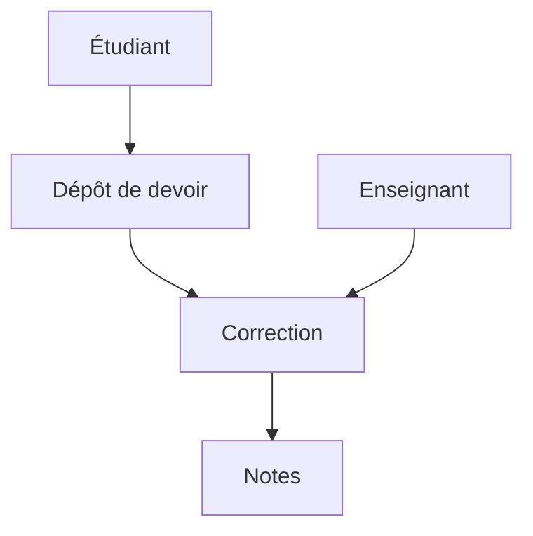

# Submitty/Submitty

> Système libre de gestion de cours, de dépôt de devoirs et de correction, issu de l'université RPI.

## Le problème
Les enseignants en informatique ont besoin de corriger automatiquement des devoirs de code et de gérer examens et notes.

## Ce que ça fait vraiment
Le README ne le détaille pas : il renvoie à submitty.org pour les fonctions et les instructions. D'après la description, c'est un système de gestion de cours, de dépôt, d'examens et de notation.

## Comment c'est branché
Schéma simplifié d'après la fiche, sans diagramme fourni.

## Essayer
Aucune commande documentée : les instructions sont sur submitty.org.

## Coût et pièges
Non documenté dans le README. Un système complet de cours se déploie sur un serveur : installation à lire sur le site.

## Ce que ce n'est pas
Pas un outil de MLOps : c'est une plateforme éducative. Matière insuffisante pour juger de l'architecture.

## Alternatives
Aucune alternative citée dans le README.

## Pour toi
Ignorer : plateforme de cours hors périmètre, sauf si tu enseignes ou corriges du code en masse.

