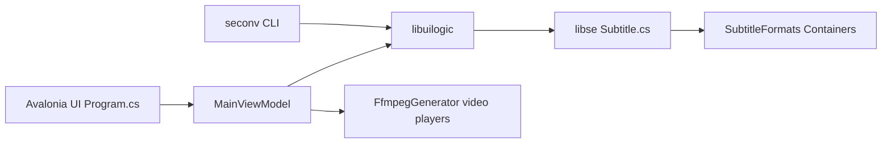

# SubtitleEdit/subtitleedit

> Cross-platform subtitle editor with command-line conversion, OCR and translation.

## The problem
Creating, fixing, synchronizing and converting subtitles between dozens of formats, including those embedded in the video.

## What it actually does
Avalonia interface on a `libse` core (subtitle model, text formats, MP4/Matroska/PGS containers). `libuilogic` adds OCR, translation through providers, and spell checking. FFmpeg, libmpv or libVLC handle playback and waveforms. The `seconv` tool converts without an interface.

## How it is wired


## Trying it
```bash
flatpak install SubtitleEdit-linux-x64.flatpak
flatpak run dk.nikse.subtitleedit
```

## Cost and gotchas
Free and offline. Third-party services (translation, speech to text, online OCR) send data to the chosen provider. On native Linux, install mpv and ffmpeg.

## What it is not
Not a cloud service; the AI features depend on external providers.

## Alternatives
No alternative named in the README.

## For you
Keep an eye on it: occasionally useful for touching up subtitle transcripts generated by an ASR; outside your core field.
