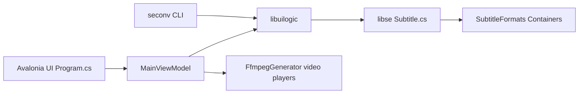

# SubtitleEdit/subtitleedit

> Éditeur de sous-titres multiplateforme avec conversion en ligne de commande, OCR et traduction.

## Le problème
Créer, corriger, synchroniser et convertir des sous-titres entre dizaines de formats, y compris ceux incrustés dans la vidéo.

## Ce que ça fait vraiment
Interface Avalonia sur un cœur `libse` (modèle de sous-titre, formats texte, conteneurs MP4/Matroska/PGS). `libuilogic` ajoute OCR, traduction par fournisseurs, correction orthographique. FFmpeg, libmpv ou libVLC servent à la lecture et aux formes d'onde. L'outil `seconv` convertit sans interface.

## Comment c'est branché


## Essayer
```bash
flatpak install SubtitleEdit-linux-x64.flatpak
flatpak run dk.nikse.subtitleedit
```

## Coût et pièges
Gratuit et hors ligne. Les services tiers (traduction, parole vers texte, OCR en ligne) envoient des données au fournisseur choisi. Sous Linux natif, installer mpv et ffmpeg.

## Ce que ce n'est pas
Pas un service cloud ; les fonctions IA dépendent de fournisseurs externes.

## Alternatives
Aucune alternative nommée dans le README.

## Pour toi
Surveiller : utile ponctuellement pour retoucher des transcriptions de sous-titres générées par un ASR ; hors cœur de métier.

