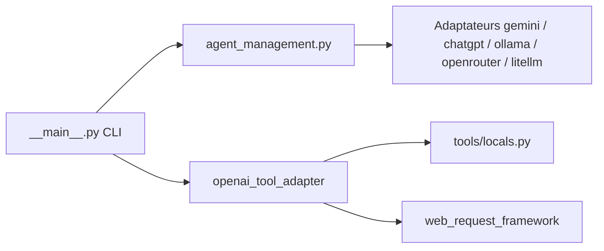

# SudoHopeX/KaliGPT

> Command-line AI assistant for Linux, cybersecurity-oriented, that routes to several model providers.

## The problem
Querying a model on security tasks forces you to leave the terminal and juggle between providers.

## What it actually does
- The `kaligpt` command sends a prompt to Gemini (default), Ollama, OpenRouter, OpenAI or LiteLLM.
- An agent mode exposes tools: local actions on the machine (`locals.py`), web requests, search via OpenSearchAPI.
- Switches model within a session (`/change-model`), manages keys, opens the official web chats.
- Installers for Arch, Debian-like and Termux.

## How it is wired


## Trying it
```bash
curl -sL https://raw.githubusercontent.com/SudoHopeX/KaliGPT/refs/heads/hackerx/install.sh | bash
sudo bash kaligptinstaller.sh
kaligpt -h
kaligpt -g "How to Scan a website for subdomains using tools"
```

## Cost and gotchas
API key for the online providers; Ollama locally otherwise. Installation goes through `curl | bash`, and the local tools give the model a hold on your machine.

## What it is not
Not a stabilized tool: the README warns it is under active development. Not a right to act on third-party targets: the README forbids any unauthorized use. The license is not identified.

## Alternatives
No alternative named in the README.

## For you
Ignore: a prompt router on top of providers you can already call, single maintainer, unclear license and installation through a remote script.
