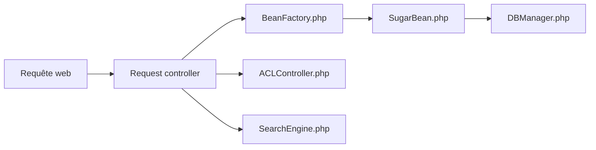

# SuiteCRM/SuiteCRM

> Self-hosted open source CRM (version 7.15.2), for companies that manage their customer relationships.

## The problem
Managing contacts, sales and customer follow-up in a tool whose data you control, without a mandatory subscription.

## What it actually does
PHP application on a LAMP stack (Apache or IIS, PHP 8.1 to 8.4, MySQL, MariaDB or MSSQL). Judging from the code: CRM records (`SugarBean`), access control, search engine (basic, Lucene, Elasticsearch, SQL), module installation, calendar synchronization, reports and V8 API. The README announces SuiteCRM 8 as the next version, still incomplete.

## How it is wired

## Trying it
No command in the README: it points to the installation guide and the compatibility matrix.

## Cost and gotchas
Free software; managed paid hosting offered by SuiteCRM Ltd. AGPL-3.0 license. More than 1,300 open issues.

## What it is not
Not the latest version: SuiteCRM 8 exists. Do not upload anything personal to the public demo.

## Alternatives
No alternative named in the README.

## For you
Ignore: a CRM has no link with your data/AI/MLOps work.
