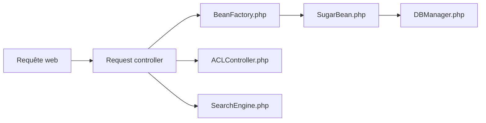

# SuiteCRM/SuiteCRM

> CRM open source auto-hébergé (version 7.15.2), pour entreprises qui gèrent leurs relations clients.

## Le problème
Gérer contacts, ventes et suivi client dans un outil dont tu contrôles les données, sans abonnement imposé.

## Ce que ça fait vraiment
Application PHP sur pile LAMP (Apache ou IIS, PHP 8.1 à 8.4, MySQL, MariaDB ou MSSQL). D'après le code : fiches CRM (`SugarBean`), contrôle d'accès, moteur de recherche (base, Lucene, Elasticsearch, SQL), installation de modules, synchronisation de calendrier, rapports et API V8. Le README annonce SuiteCRM 8 comme version suivante, encore incomplète.

## Comment c'est branché

## Essayer
Aucune commande dans le README : renvoi au guide d'installation et à la matrice de compatibilité.

## Coût et pièges
Logiciel gratuit ; hébergement géré payant proposé par SuiteCRM Ltd. Licence AGPL-3.0. Plus de 1 300 issues ouvertes.

## Ce que ce n'est pas
Pas la dernière version : SuiteCRM 8 existe. Ne rien téléverser de personnel dans la démo publique.

## Alternatives
Aucune alternative nommée dans le README.

## Pour toi
À ignorer : un CRM n'a pas de lien avec ton travail data/IA/MLOps.

