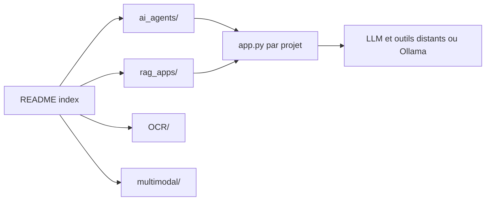

# Sumanth077/Hands-On-AI-Engineering

> Monorepo of dozens of small AI projects (agents, RAG, OCR, audio, multimodal) for learning by example.

## The problem
Finding complete, runnable examples of agents or RAG, without rebuilding them from documentation snippets.

## What it actually does
Each project lives in its own folder (`ai_agents/`, `rag_apps/`, `OCR/`, `audio/`, `multimodal/`, `fine_tuning/`) with its `app.py`, its dependencies and its `.env.example`. The README lists more than forty agents (multi-agent research, financial analysis, natural-language SQL, PR review…), RAG variants (graph, hybrid, HyDE, database routing), medical OCR and a fine-tuning example. There is no common foundation.

## How it is wired

## Trying it
No command is documented at the root: each project folder has its own README. The README requires `requirements.txt` or `pyproject.toml` and `.env.example` in each project.

## Cost and gotchas
Providers vary (OpenAI, Anthropic, Gemini, Mistral, DeepSeek, MiniMax, NVIDIA NIM): as many keys, often paid. Some examples run locally with Ollama or llama.cpp. An environment must be created per project.

## What it is not
Not a library nor a product: independent demos of uneven quality, with no declared license. The README's claim of examples suited to real use is not verified.

## Alternatives
No alternative is cited in the README.

## For you
Worth watching as a reserve of ideas and agent patterns; with no license and no common foundation, copy nothing from it without checking.
