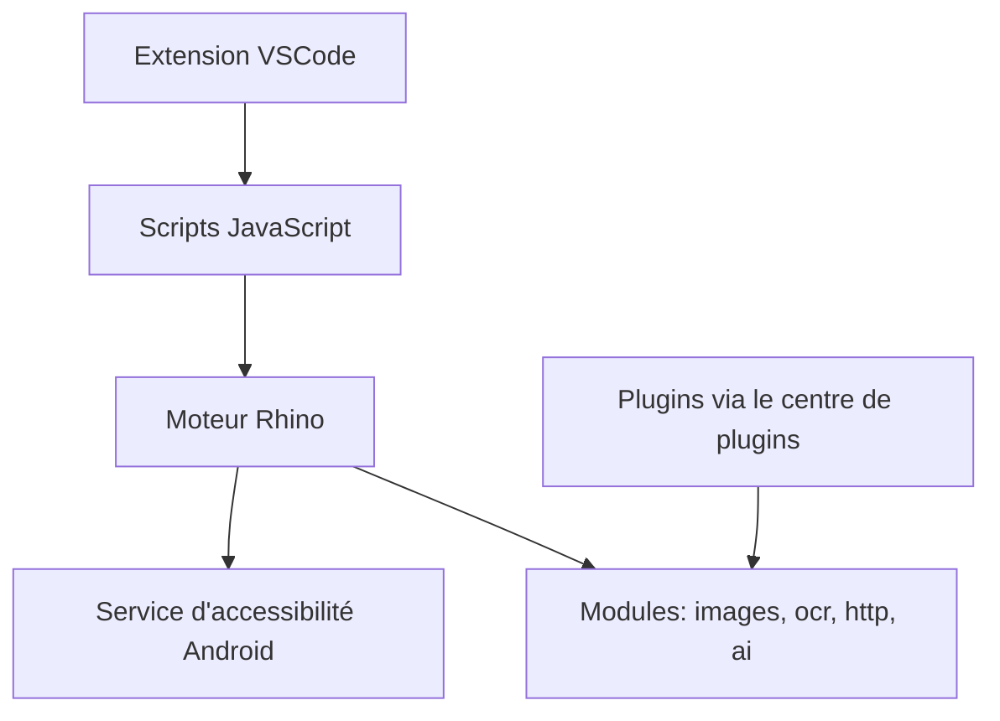

# SuperMonster003/AutoJs6

> Android app for automation through JavaScript scripts via accessibility, an active fork of Auto.js.

## The problem
Auto.js stopped being maintained in 2020; its Android automation scripts no longer work well on recent systems.

## What it actually does
Runs JavaScript scripts that drive Android through the accessibility service: control selectors, screen capture, image search, XML-based interface, APK export. Adds Shizuku, WebSocket, several modules, a VSCode connector and plugins (OCR, Node runtimes, Python...). Version 6.8.0 makes several functions optional through plugins and changes some Promise behaviors.

## How it is wired
Simplified diagram based on the fiche, no diagram provided.



## Trying it
No command in the part of the README that was read; works on Android API 24 and above.

```bash
# non documenté : installation de l'APK, voir la documentation du projet
```

## Cost and gotchas
Free. Android 7 minimum. 6.8.0 is flagged "update with caution". Many functions require extended permissions, possibly Shizuku or Root. README in Chinese, truncated in the material provided.

## What it is not
Not an MLOps or data science tool. It automates a phone, not a pipeline.

## Alternatives
- AutoX (aiselp): another Auto.js fork listed in the README.
- Auto.js Pro 9: the original paid version.

## For you
Ignore: mobile automation tool with no direct relation to your data / AI profile, except for testing Android applications.
