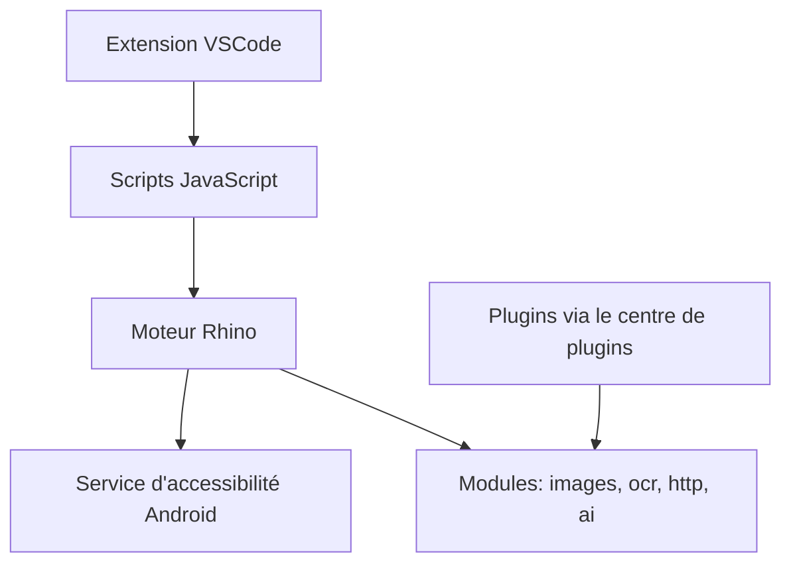

# SuperMonster003/AutoJs6

> Application Android d'automatisation par scripts JavaScript via l'accessibilité, fork actif d'Auto.js.

## Le problème
Auto.js a cessé d'être maintenu en 2020 ; ses scripts d'automatisation Android ne fonctionnent plus bien sur les systèmes récents.

## Ce que ça fait vraiment
Exécute des scripts JavaScript qui pilotent Android via le service d'accessibilité : sélecteurs de contrôles, capture d'écran, recherche d'image, interface par XML, export en APK. Ajoute Shizuku, WebSocket, plusieurs modules, un connecteur VSCode et des plugins (OCR, runtimes Node, Python...). La version 6.8.0 rend plusieurs fonctions optionnelles via des plugins et change certains comportements de Promise.

## Comment c'est branché
Schéma simplifié d'après la fiche, sans diagramme fourni.



## Essayer
Aucune commande dans la partie lue du README ; fonctionne sur Android API 24 et supérieur.

```bash
# non documenté : installation de l'APK, voir la documentation du projet
```

## Coût et pièges
Gratuit. Android 7 minimum. La 6.8.0 est signalée « à mettre à jour avec prudence ». Beaucoup de fonctions exigent des permissions étendues, éventuellement Shizuku ou Root. README en chinois, tronqué dans la matière fournie.

## Ce que ce n'est pas
Pas un outil de MLOps ni de data science. Il automatise un téléphone, pas un pipeline.

## Alternatives
- AutoX (aiselp) : autre fork d'Auto.js listé dans le README.
- Auto.js Pro 9 : version payante d'origine.

## Pour toi
À ignorer : outil d'automatisation mobile sans rapport direct avec ton profil data / IA, sauf test d'applications Android.

