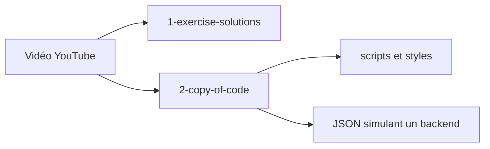

# SuperSimpleDev/javascript-course

> Exercise solutions and end-of-lesson code for a beginner JavaScript video course.

## The problem
Following a video course without answer keys or final code means retyping or guessing the solutions.

## What it is not only
The README is only three lines: a link to the YouTube video, two folders (`1-exercise-solutions`, `2-copy-of-code`) and a paid or external certificate on the course website.

## What it actually does
A repository of HTML, CSS and JavaScript with no build, organized by lesson. Lessons 13 to 18 use JSON files as a fake backend, and lessons 16 to 18 use Jasmine tests, according to the code.

## How it is wired

## Trying it
No command documented in the README.

## Cost and gotchas
Free. No license declared: copying the code outside of learning is not explicitly permitted. Last push on 2025-05-06.

## What it is not
It is neither a written course nor a library: without the video, there is little context.

## Alternatives
No alternative named in the README.

## For you
Ignore: companion material for a beginner JavaScript course, with no clear license, of no interest to a data or MLOps profile.
