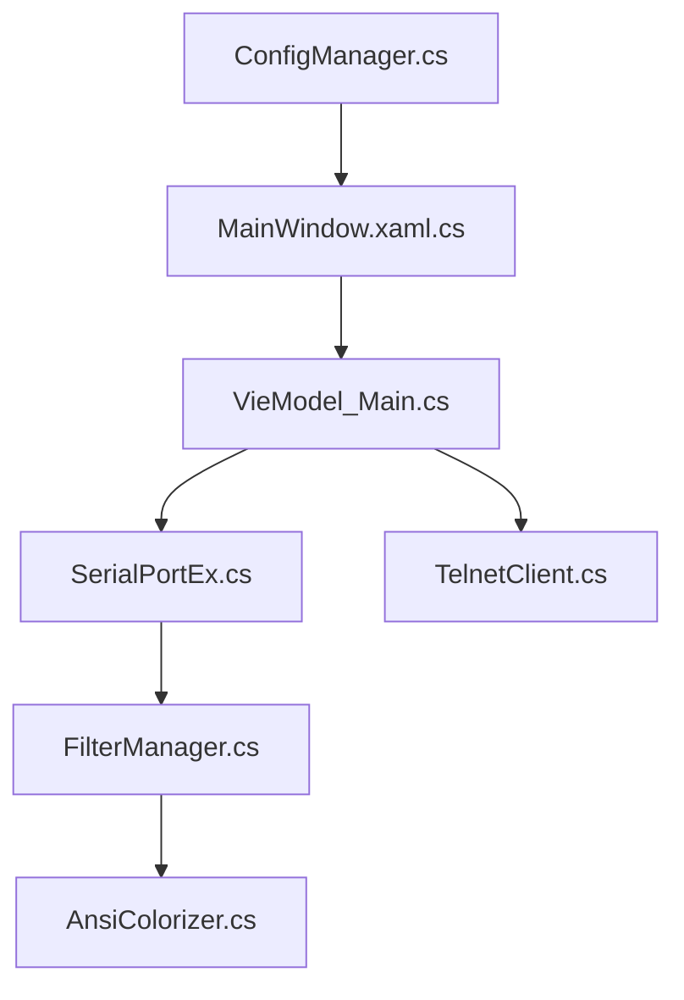

# SuperStudio/SuperCom

> Windows tool for debugging serial ports: log collection, storage and color display.

## The problem
Monitoring several serial ports and keeping their logs calls for austere tools.

## What it actually does
WPF application: listens to several serial ports at once, saves logs automatically, fixed or free scrolling, baud rate setting, sending AT commands, syntax coloring, hex/text conversion, JSON formatting, Telnet client. Virtual ports come from com0com. Version 4.5 is the last to receive features: the project is migrating to SuperConnectX.

## How it is wired

## Trying it
No command documented: the README points to a download link and the Wiki.

## Cost and gotchas
Free, Windows only. README in Chinese. Features frozen since 4.5, only critical fixes are planned.

## What it is not
Not a cross-platform tool, despite its reasons for leaving WPF: the migration to another product is under way.

## Alternatives
SuperConnectX, the replacement project cited in the README.

## For you
Ignore: Windows utility for embedded electronics, outside your data/AI profile; and the project itself points to its successor.
