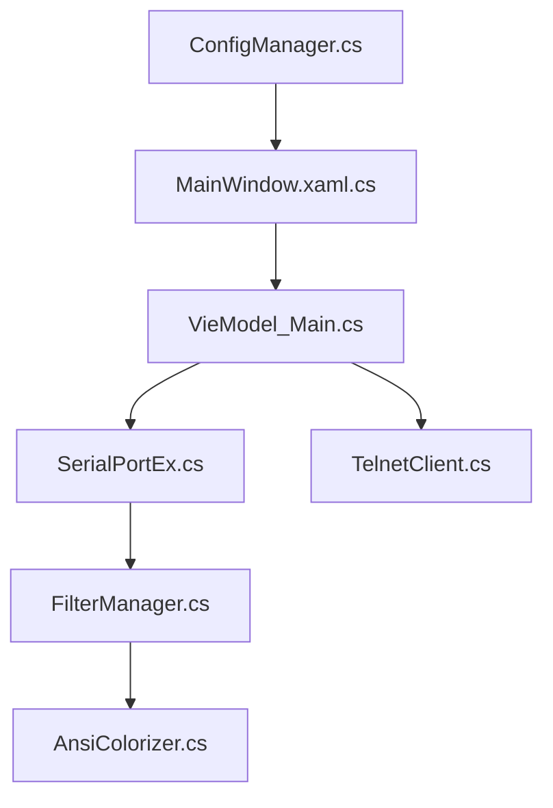

# SuperStudio/SuperCom

> Outil Windows de débogage de ports série : collecte, stockage et affichage coloré des journaux.

## Le problème
Surveiller plusieurs ports série et garder leurs journaux demande des outils austères.

## Ce que ça fait vraiment
Application WPF : écoute de plusieurs ports série à la fois, sauvegarde automatique des journaux, défilement fixe ou libre, réglage du débit, envoi de commandes AT, coloration syntaxique, conversion hex/texte, formatage JSON, client Telnet. Les ports virtuels viennent de com0com. La version 4.5 est la dernière à recevoir des fonctions : le projet migre vers SuperConnectX.

## Comment c'est branché

## Essayer
Aucune commande documentée : le README renvoie vers un lien de téléchargement et le Wiki.

## Coût et pièges
Gratuit, Windows seulement. README en chinois. Fonctions gelées depuis 4.5, seuls les correctifs critiques sont prévus.

## Ce que ce n'est pas
Pas un outil multiplateforme, malgré ses raisons de quitter WPF : la migration vers un autre produit est en cours.

## Alternatives
SuperConnectX, le projet de remplacement cité dans le README.

## Pour toi
Ignorer : utilitaire Windows pour l'électronique embarquée, hors de ton profil data/IA ; et le projet pointe lui-même vers son successeur.

