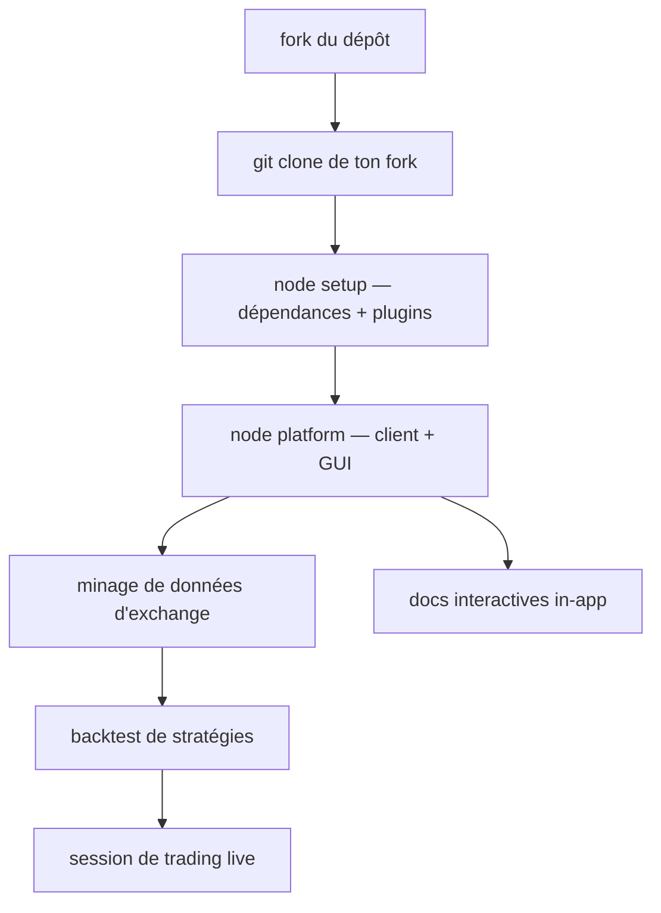

# Superalgos/Superalgos

> Community platform for automated trading: data mining, backtesting and live sessions.

## The problem
Building a trading strategy requires aggregating market data, replaying it, then going live without rewriting everything.
Existing platforms are closed and paid.

## What it actually does
A local application (Node client + browser GUI) that mines exchange data, backtests strategies and runs real trading sessions.
Built-in interactive tutorials guide learning of the interface, mining, backtesting up to the live session; the README insists on doing them all.
The internal documentation runs to more than 1500 pages, interactive and searchable in the app, more up to date than the web version.
Deployment extends from PC to Raspberry Pi, Docker and public cloud, with a `minMemo` option for machines with 8 GB or less.

## How it is wired


## Trying it
```bash
git clone https://github.com/John/Superalgos
cd Superalgos
node setup
node platform
node platform minMemo
```

## Cost and gotchas
The fork is not optional: the installation scripts build the app from several repositories, and a GitHub personal access token with the `repo` and `workflow` scopes is required.
An exchange account (Binance or Binance US in the tutorial) is needed for the live part; under 1 GB of RAM the README recommends staying on Node 16.

## What it is not
It is not neutral software: it is backed by a native "SA" token distributed to contributors, and the fork also serves this model.
It is not tested everywhere — the UI is only validated on Chrome and Safari. The TensorFlow integration is described as partial and incomplete.
The README devotes a box to impersonation scams in its Telegram groups.

## Alternatives
No alternative is named in the README.

## For you
Out of scope: token-based project, heavy GUI, embryonic ML — the entry effort is not justified by the data side.
