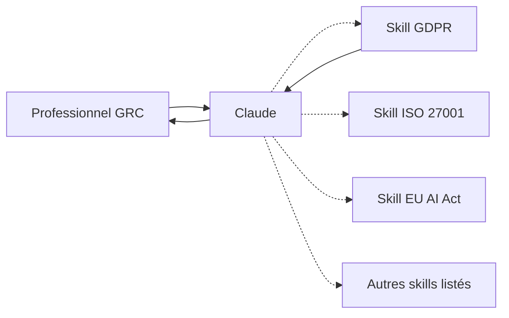

# Sushegaad/Claude-Skills-Governance-Risk-and-Compliance

> Catalogue of Claude skills for compliance: ISO 27001, SOC 2, GDPR, HIPAA, AI Act and more.

## The problem
Answering precisely about a regulatory framework requires exact references that the model does not always cite well on its own.

## What it actually does
Each `.skill` file contains a `SKILL.md` loaded when the topic comes up, plus references loaded on demand. They cover dozens of frameworks and produce gap analyses, policies, risk registers and templates. The authors claim a 90% success rate versus 49% without the skill, over 180 test cases.

## How it is wired

## Trying it
No command in the README: you upload the desired `.skill` file (for example `GDPR - Claude Skill/gdpr-compliance.skill`) into Claude, then it activates on its own over the course of conversations.

## Cost and gotchas
Free, but you need a Claude account that supports skills. Regulatory content dates quickly: cross-check with the official texts. The README, truncated here, was not read in full.

## What it is not
Not legal advice nor a certification. The 90% score comes from the authors and is not verified here.

## Alternatives
No alternative named in the README.

## For you
Worth watching: the AI Act, ISO 42001 and GDPR skills help frame an AI project in Europe, subject to review by a lawyer.
