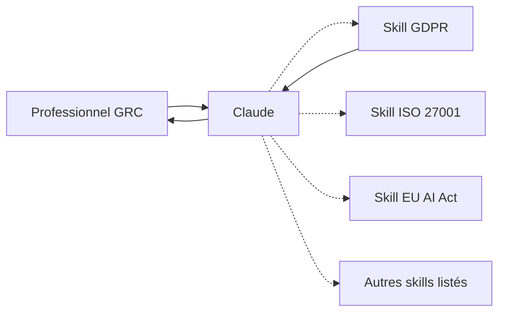

# Sushegaad/Claude-Skills-Governance-Risk-and-Compliance

> Catalogue de skills Claude pour la conformité : ISO 27001, SOC 2, RGPD, HIPAA, AI Act et plus.

## Le problème
Répondre précisément sur un cadre réglementaire demande des références exactes que le modèle ne cite pas toujours bien de lui-même.

## Ce que ça fait vraiment
Chaque fichier `.skill` contient un `SKILL.md` chargé quand le sujet apparaît, plus des références chargées à la demande. Ils couvrent des dizaines de cadres et produisent analyses d'écarts, politiques, registres de risques et gabarits. Les auteurs annoncent 90 % de réussite contre 49 % sans skill, sur 180 cas de test.

## Comment c'est branché

## Essayer
Aucune commande dans le README : on téléverse le fichier `.skill` voulu (par exemple `GDPR - Claude Skill/gdpr-compliance.skill`) dans Claude, puis il s'active seul au fil des conversations.

## Coût et pièges
Gratuit, mais il faut un compte Claude qui accepte les skills. Le contenu réglementaire date vite : à recouper avec les textes officiels. Le README, tronqué ici, n'a pas été lu en entier.

## Ce que ce n'est pas
Pas un conseil juridique ni une certification. Le score de 90 % vient des auteurs et n'est pas vérifié ici.

## Alternatives
Aucune alternative nommée dans le README.

## Pour toi
À surveiller : les skills AI Act, ISO 42001 et RGPD servent à cadrer un projet IA en Europe, sous réserve de relecture par un juriste.

