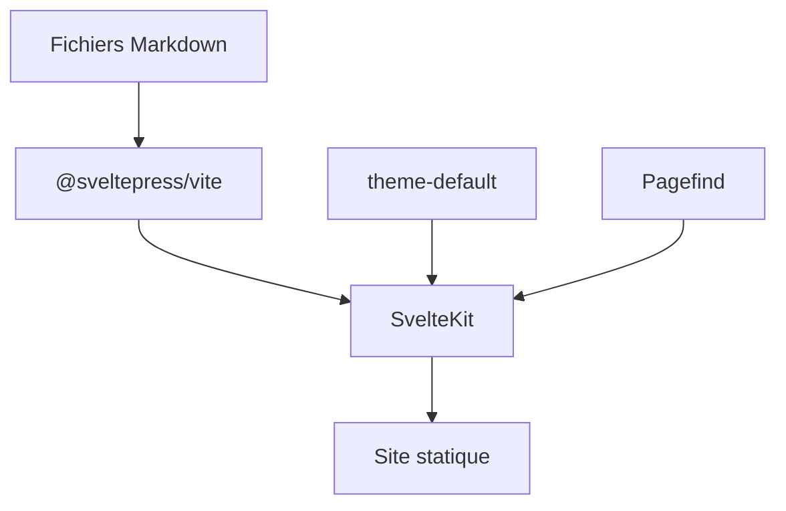

# SveltePress/sveltepress

> Static docs and blog site generator on SvelteKit, with Markdown enriched by Svelte 5.

## The problem
Writing versioned, multilingual documentation while keeping the full power of SvelteKit, without switching to VitePress or Docusaurus.

## What it actually does
- Markdown with built-in Svelte 5 components and runes.
- Immutable document versioning, i18n, Pagefind, DocSearch or Meilisearch search.
- Docs and blog themes (RSS, OG images), automatic `llms.txt` generation.
- Separate packages: `@sveltepress/vite`, `theme-default`, `theme-blog`, `twoslash`.

## How it is wired

Simplified diagram based on the sheet, no diagram provided.

## Trying it
```bash
npm create @sveltepress@latest
```

## Cost and gotchas
Free. Requires Svelte 5, SvelteKit 2 or 3, Vite 8 and Node 20.19 or 22.12 and above. Unrelated to the archived GeopJr/SveltePress project.

## What it is not
Not a generic documentation tool: it assumes the Svelte ecosystem. The comparisons in the table are the author's own.

## Alternatives
VitePress if you are on Vue; Starlight (Astro) if you want multi-framework; Docusaurus if you are on React.

## For you
Ignore: useful for a Svelte documentation site, but nothing for data or AI; MkDocs or Docusaurus serve an ML project's docs better.
