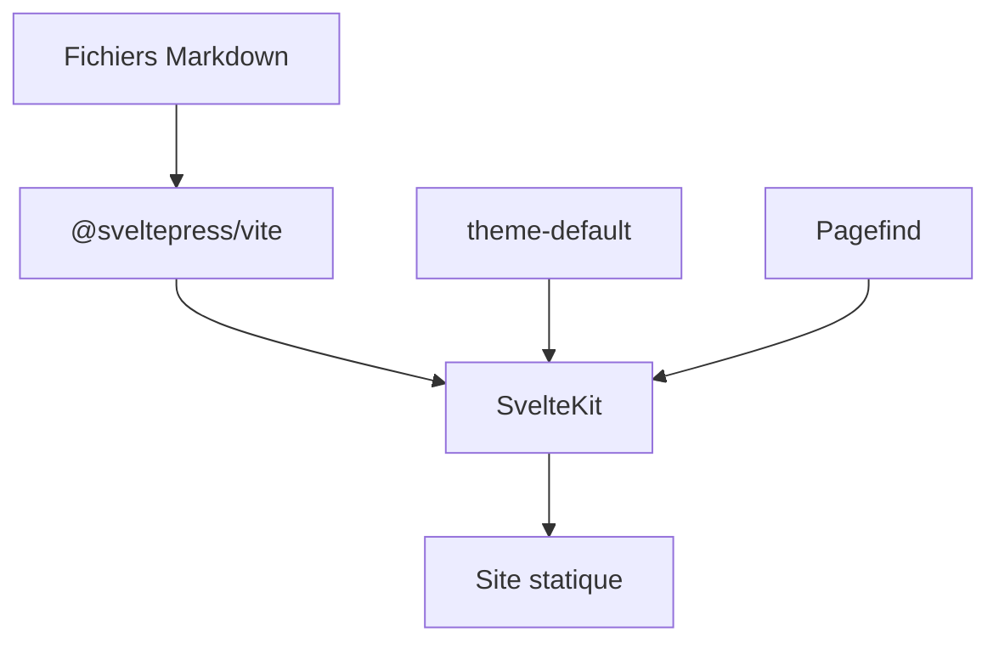

# SveltePress/sveltepress

> Générateur de sites de docs et de blogs statiques sur SvelteKit, avec du Markdown enrichi de Svelte 5.

## Le problème
Écrire une documentation versionnée et multilingue en gardant toute la puissance de SvelteKit, sans basculer sur VitePress ou Docusaurus.

## Ce que ça fait vraiment
- Markdown avec composants et runes Svelte 5 intégrés.
- Versionnage immuable des documents, i18n, recherche Pagefind, DocSearch ou Meilisearch.
- Thèmes docs et blog (RSS, images OG), génération automatique de `llms.txt`.
- Paquets séparés : `@sveltepress/vite`, `theme-default`, `theme-blog`, `twoslash`.

## Comment c'est branché

Schéma simplifié d'après la fiche, sans diagramme fourni.

## Essayer
```bash
npm create @sveltepress@latest
```

## Coût et pièges
Gratuit. Exige Svelte 5, SvelteKit 2 ou 3, Vite 8 et Node 20.19 ou 22.12 et plus. Sans lien avec le projet archivé GeopJr/SveltePress.

## Ce que ce n'est pas
Pas un outil de documentation générique : il suppose l'écosystème Svelte. Les comparaisons du tableau sont celles de l'auteur.

## Alternatives
VitePress si tu es sous Vue ; Starlight (Astro) si tu veux du multi-framework ; Docusaurus si tu es sous React.

## Pour toi
À ignorer : utile pour un site de documentation Svelte, mais rien pour la donnée ou l'IA ; MkDocs ou Docusaurus servent mieux une doc de projet ML.

