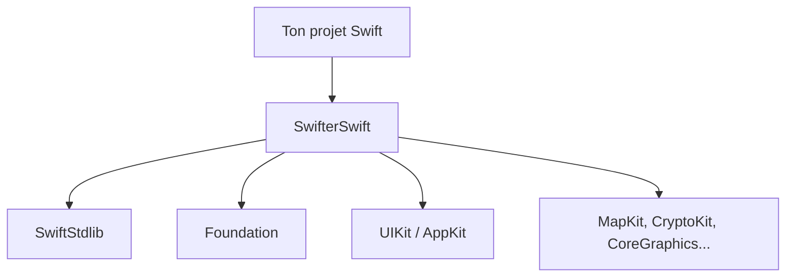

# SwifterSwift/SwifterSwift

> Collection of more than 500 native Swift extensions for iOS, macOS, tvOS and watchOS developers.

## The problem
The standard Swift and Apple APIs force you to keep rewriting small utilities for strings, dates, views and collections.

## What it actually does
Adds properties and methods to Swift types and to UIKit, AppKit, Foundation, CoreGraphics, CryptoKit, MapKit and other classes. Modular installation by CocoaPods subspec, or by Carthage and Swift Package Manager. Requires Swift 5.6 or later.

## How it is wired

Diagram inferred from the README, no code diagram provided.

## Trying it
```bash
pod 'SwifterSwift'
```
Swift Package Manager: `.package(url: "https://github.com/SwifterSwift/SwifterSwift.git", from: "6.0.0")`.

## Cost and gotchas
Free. Only targeted subspecs avoid embedding the whole package.

## What it is not
Not an application framework, nor cross-platform outside the Swift ecosystem. No link with Python: the prerequisite value is a list constraint, the real prerequisite is Swift 5.6+.

## Alternatives
No alternative named in the README.

## For you
Ignore: a Swift library unrelated to data, AI or MLOps work, unless you develop Apple apps.
