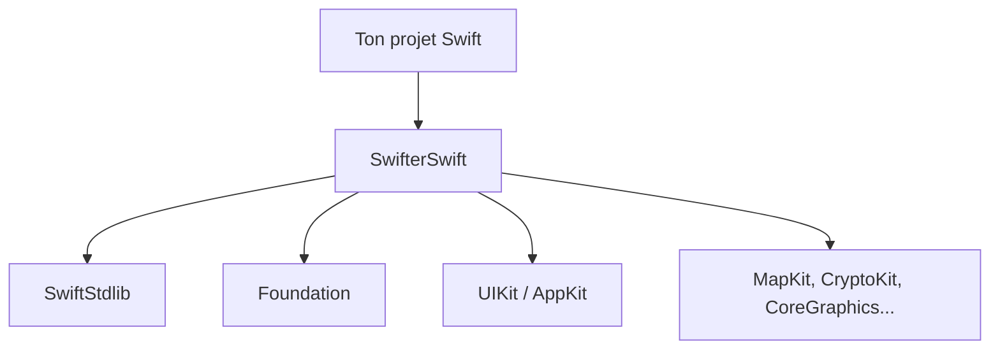

# SwifterSwift/SwifterSwift

> Collection de plus de 500 extensions Swift natives pour développeurs iOS, macOS, tvOS et watchOS.

## Le problème
Les API standard de Swift et d'Apple obligent à réécrire sans cesse de petits utilitaires pour chaînes, dates, vues et collections.

## Ce que ça fait vraiment
Ajoute des propriétés et méthodes aux types Swift et aux classes UIKit, AppKit, Foundation, CoreGraphics, CryptoKit, MapKit et autres. Installation modulaire par sous-spécification CocoaPods, ou par Carthage et Swift Package Manager. Exige Swift 5.6 ou plus.

## Comment c'est branché

Schéma déduit du README, sans diagramme de code fourni.

## Essayer
```bash
pod 'SwifterSwift'
```
Swift Package Manager : `.package(url: "https://github.com/SwifterSwift/SwifterSwift.git", from: "6.0.0")`.

## Coût et pièges
Gratuit. Seules des sous-spécifications ciblées évitent d'embarquer tout le paquet.

## Ce que ce n'est pas
Pas un framework d'application, ni cross-platform hors écosystème Swift. Aucun lien avec Python : la valeur de prérequis est une contrainte de liste, le vrai prérequis est Swift 5.6+.

## Alternatives
Aucune alternative nommée dans le README.

## Pour toi
À ignorer : bibliothèque Swift sans rapport avec le travail data, IA ou MLOps, sauf si tu développes des apps Apple.

