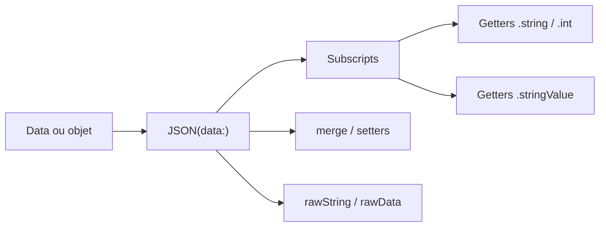

# SwiftyJSON/SwiftyJSON

> Swift library to read and modify JSON without chaining type conversions, for Apple developers.

## The problem
Swift's strict typing makes extracting nested JSON values verbose, with cascading conversions and optionals.

## What it actually does
Wraps a JSON in the JSON type and allows chained index or key access (`json[0]["user"]["name"].string`). It provides optional getters (.string, .int) and non-optional ones (.stringValue, returns a default value), setters, loops, a typed error (SwiftyJSONError), merging of two JSONs (merge, merged) and serialization (rawString, rawData). An invalid index yields an error, not a crash.

## How it is wired


## Trying it
```bash
# Swift Package Manager (Package.swift) puis :
swift build
# CocoaPods (Podfile) : pod 'SwiftyJSON', '~> 4.0'
# Carthage (Cartfile) : github "SwiftyJSON/SwiftyJSON" ~> 4.0
```

## Cost and gotchas
Free, MIT. Requires Xcode 16+ and Swift 6.0+ according to the README. The `xxxValue` getters hide errors by returning 0, "" or []: choose them knowingly. The excerpt does not say whether the library is still recommended compared with Codable.

## What it is not
Not a JSON-to-typed-models mapping: the README points to external model generators. Nothing specific to Python or the web.

## Alternatives
Alamofire and Moya are cited as networking layers it integrates with, not as replacements.

## For you
Ignore: library reserved for Apple app development in Swift, with no use in a data/AI/MLOps pipeline.
