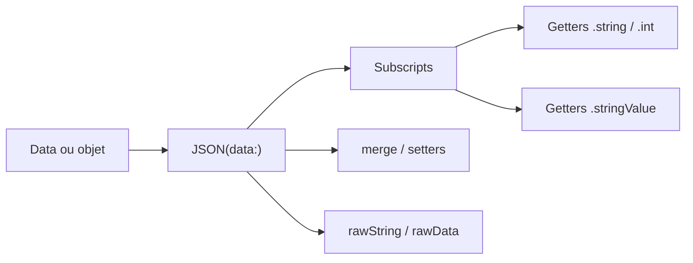

# SwiftyJSON/SwiftyJSON

> Bibliothèque Swift pour lire et modifier du JSON sans enchaîner des conversions de types, pour développeurs Apple.

## Le problème
Le typage strict de Swift rend l'extraction de valeurs JSON imbriquées verbeuse, avec des conversions et des optionnels en cascade.

## Ce que ça fait vraiment
Enveloppe un JSON dans le type JSON et permet des accès par indices ou clés chaînés (`json[0]["user"]["name"].string`). Elle fournit des getters optionnels (.string, .int) et non optionnels (.stringValue, renvoie une valeur par défaut), des setters, des boucles, une erreur typée (SwiftyJSONError), la fusion de deux JSON (merge, merged) et la sérialisation (rawString, rawData). Un indice invalide donne une erreur, pas un plantage.

## Comment c'est branché


## Essayer
```bash
# Swift Package Manager (Package.swift) puis :
swift build
# CocoaPods (Podfile) : pod 'SwiftyJSON', '~> 4.0'
# Carthage (Cartfile) : github "SwiftyJSON/SwiftyJSON" ~> 4.0
```

## Coût et pièges
Gratuit, MIT. Exige Xcode 16+ et Swift 6.0+ selon le README. Les getters `xxxValue` masquent les erreurs en renvoyant 0, "" ou [] : à choisir en connaissance de cause. L'extrait ne dit pas si la bibliothèque est toujours recommandée face à Codable.

## Ce que ce n'est pas
Pas un mapping JSON vers modèles typés : le README renvoie vers des générateurs de modèles externes. Rien de spécifique à Python ou au web.

## Alternatives
Alamofire et Moya sont cités comme couches réseau avec lesquelles elle s'intègre, pas comme remplaçants.

## Pour toi
Ignorer : bibliothèque réservée au développement d'apps Apple en Swift, sans usage dans un pipeline data/IA/MLOps.

