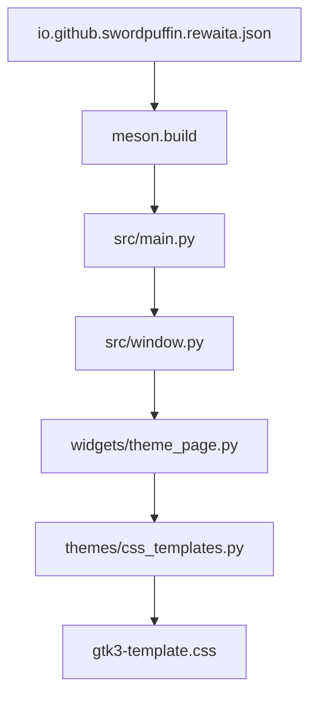

# SwordPuffin/Rewaita

> GNOME app that changes Adwaita's look by generating GTK themes, effortlessly.

## The problem
Customizing Adwaita's colors (GTK3 and GTK4, Shell) forces you to edit stylesheets by hand.

## What it actually does
The Python GTK app applies palettes (Nord, Dracula, etc.) by generating GTK stylesheets from templates. It can be used through the interface or the command line (`--theme`, `--list`). Only the Flatpak version is officially supported; AUR, openSUSE and Nix are maintained by third parties.

## How it is wired


## Trying it
```bash
flatpak install io.github.swordpuffin.rewaita
flatpak run io.github.swordpuffin.rewaita --list
flatpak run io.github.swordpuffin.rewaita --theme={theme name}
```

## Cost and gotchas
Free. You must give Flatpak write access to `gtk-3.0` and `gtk-4.0`; the known-bugs section is long (theme persisting after uninstall, blank window). GPL-3.0 license.

## What it is not
Not a ready-made theme for every environment: it targets GNOME and Adwaita.

## Alternatives
No alternative named in the README.

## For you
Ignore: Linux desktop appearance tweaking unrelated to data or MLOps.
